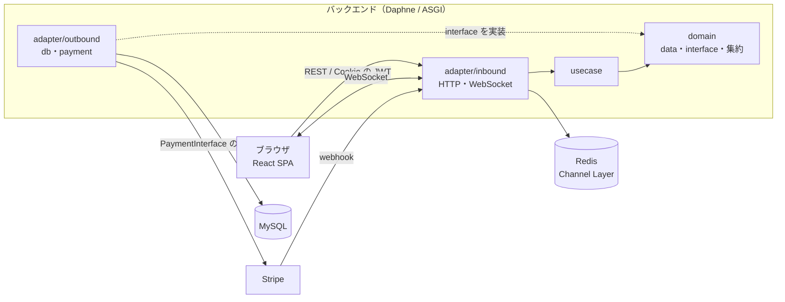
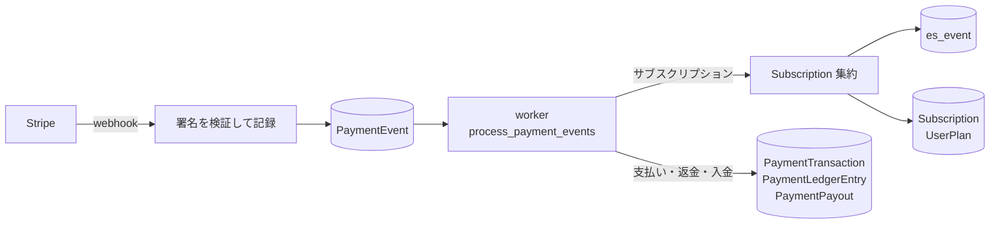

# MyUs アーキテクチャ

[README](../readme.md)

## 技術スタック

| 領域 | 技術 |
|---|---|
| バックエンド | Python 3.15 / Django 6 / django-ninja / Daphne（ASGI） / Django Channels |
| フロントエンド | React 19 / TypeScript / Vite / TanStack Router / TanStack Query / React Compiler |
| データベース・キャッシュ | MySQL 8.4 / Redis 7 |
| 決済 | Stripe |
| メディア | ffmpeg（HLS 変換） / video.js / Tiptap |
| 開発環境 | Docker Compose / uv / pnpm |
| 静的解析・テスト | mypy / ruff / pytest / ESLint / Vitest |
| CI・配信 | GitHub Actions / Vercel |

## 全体構成



- フロントエンドは SPA として Vercel から配信し、バックエンドの REST API を呼ぶ
- バックエンドは Daphne（ASGI）で HTTP と WebSocket の両方を受ける
- WebSocket のメッセージは Redis の Channel Layer で配る

## バックエンド

### レイヤー構成（`myus/myus/`）

| ディレクトリ | 役割 |
|---|---|
| `adapter/inbound/` | django-ninja のエンドポイントと WebSocket の consumer。入力の検証と、`Result` から HTTP レスポンスへの変換 |
| `adapter/outbound/db/` | repository の実装（Django ORM） |
| `adapter/outbound/payment/` | 決済会社の実装（`PaymentInterface` の Stripe 実装は `stripe/`） |
| `adapter/inbound/routers.py` | django-ninja のルーターをまとめて登録する（`config/urls.py` が読む） |
| `usecase/` | 業務ロジック |
| `domain/<ドメイン>/` | repository の interface と Data（dataclass）、ルール（`validation.py`） |
| `domain/<ドメイン>/<集約>/` | Event Sourcing の集約（状態・イベント・判断・適用）。I/O を持たない関数。いまは `domain/payment/subscription/` |
| `injectors/` | interface と実装の対応付け |
| `adapter/inbound/schema/` | API の入出力スキーマ（django-ninja の Pydantic のモデル）。adapter/inbound だけが使う |
| `usecase/dto/` | usecase の入出力の DTO（dataclass）。adapter/inbound も usecase の結果を受け取るのに使う |

usecase は interface にだけ依存し、実装は `injector` から取得する。Django ORM や Stripe の SDK は usecase から直接使わない。テストでは repository を fake に差し替える。

### エラーハンドリング

repository と usecase は例外を投げず、`Result[T, E]` を返す。

- 想定外の例外は `@Result.shield_exception()` で `FatalError` に変換する
- エラー型は `ValidationError`・`ForbiddenError`・`NotFoundError`・`ConflictError`・`HistoryCorruptedError`・`FatalError` の共通型を使う
- HTTP ステータスへの変換は adapter 層だけで行う
- 複数の書き込みは `atomic_result` で1つのトランザクションにまとめ、Err が返ったらロールバックする

詳細は [backend.md](backend.md) を参照。

## フロントエンド

### ディレクトリ構成（`frontend/src/`）

| ディレクトリ | 役割 |
|---|---|
| `api/` | API の呼び出し。結果は `neverthrow` の `Result` で返す |
| `lib/` | axios・TanStack Query・i18n の設定とルーティング（`lib/routes.tsx`） |
| `components/parts/` | ボタン・入力などの小さな部品 |
| `components/widgets/` | 部品を組み合わせた単位（コメント・プレイヤー・モーダルなど） |
| `components/layout/` | ヘッダー・サイドバー・フッター |
| `components/pages/` | ページ |
| `components/hooks/`・`components/provider/` | カスタムフック・Context |
| `types/`・`utils/`・`styles/` | 型定義・共通関数・SCSS |

- ルーティングは TanStack Router、データの取得とキャッシュは TanStack Query で行う
- ページごとに loader でデータを先に取得する

詳細は [frontend.md](frontend.md)・[css.md](css.md) を参照。

## リアルタイム通信・メディア配信

- チャットのメッセージとスレッドは Django Channels の WebSocket で送受信する
- 動画・音楽はアップロード時に ffmpeg で HLS に変換し、video.js で再生する
- ブログなどの本文は Tiptap で編集し、表示時に DOMPurify で無害化する

## 決済

Stripe から届いたイベント（`PaymentEvent`）と、サブスクリプションの集約の履歴（`es_event`）を正とし、ほかのテーブルはそこから作る投影にする。イベントを流し直せば作り直せる。



```
PaymentEvent              決済会社から届いたイベント（追記のみ）
es_event                  集約の履歴（追記のみ）
PaymentCustomer           ユーザーと決済会社の顧客 ID
 ├─ Subscription          継続課金の状態（集約の状態から作る）
 └─ PaymentTransaction    1回の請求・支払い（金額は明細の合計）
     └─ PaymentLedgerEntry  帳簿の明細（売上・返金・決済手数料。追記のみ）
PaymentPayout             銀行口座への入金
```

- webhook は検証と記録だけにし、反映は worker（docker-compose の `myus_worker`）が古い順に行う
- `PaymentEvent` は `provider` と `event_id` で一意にし、同じイベントは1回だけ処理する
- サブスクリプションの届く順番は集約が判断する。取引・入金は、最後に反映したイベントの日時より古いイベントを反映しない
- 申し込み後の操作（プランの変更・解約・解約の取り消し）も、Stripe の結果を集約に通して記録する
- お金が動かないイベント（0円の請求など）は記録しない
- 帳簿の明細は削除できない（`on_delete=PROTECT`）
- Stripe への依存は `PaymentInterface` の実装に閉じ込める

| コマンド | 内容 |
|---|---|
| `uv run python manage.py process_payment_events` | 未反映のイベントを反映する worker |
| `uv run python manage.py export_ledger --from 2026-01-01 --to 2026-12-31` | 期間の明細を CSV で出力する |
| `uv run python manage.py replay_payment_events --confirm` | イベントを流し直して投影を作り直す |

詳細は [myus.md](myus.md) の「決済システム」と [roadmap.md](roadmap.md) を参照。

## 静的解析・CI

| 対象 | 内容 |
|---|---|
| バックエンド | mypy（strict）・ruff・`manage.py check`・pytest（`.github/workflows/backend.yml`） |
| フロントエンド | ESLint・tsc・Vitest・ビルド（`.github/workflows/frontend.yml`） |

## ローカル開発

### バックエンド

```bash
# myus/envs/ に django.env・mysql.env・redis.env を用意する（envs/sample.env を参考にする）
docker compose up -d
docker compose exec myus_backend python manage.py migrate --settings config.settings.local
# http://127.0.0.1:8056
```

### フロントエンド

```bash
cd frontend
pnpm install
cp .env.sample .env.local
pnpm dev  # http://127.0.0.1:3000
```

### チェック

```bash
# myus/
uv run mypy myus config tests
uv run ruff check myus config tests --extend-ignore I
uv run pytest

# frontend/
pnpm check
pnpm test
```
