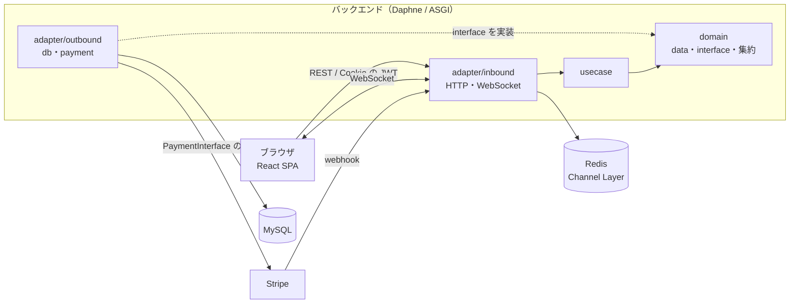
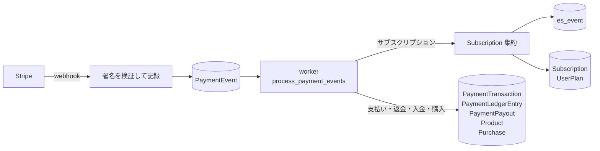

# MyUs アーキテクチャ

[README](../readme.md)

## 技術スタック

| 領域 | 技術 |
|---|---|
| バックエンド | Python 3.15 / Django 6 / django-ninja / Daphne（ASGI） / Django Channels |
| フロントエンド | React 19 / TypeScript / Vite / TanStack Router / TanStack Query / React Compiler |
| データベース・キャッシュ | MySQL 8.4 / Redis 7 |
| 決済 | Stripe |
| メディア | ffmpeg（HLS 変換） / video.js / Tiptap |
| 開発環境 | Docker Compose / uv / pnpm |
| 静的解析・テスト | mypy / ruff / pytest / ESLint / Vitest |
| CI・配信 | GitHub Actions / S3 + CloudFront |
| 本番のインフラ | AWS（EC2・RDS・S3・CloudFront・SSM）/ Terraform（[infrastructure.md](infrastructure.md)） |

## 全体構成



- フロントエンドは SPA として S3 と CloudFront から配信し、バックエンドの REST API を呼ぶ
- バックエンドは Daphne（ASGI）で HTTP と WebSocket の両方を受ける
- WebSocket のメッセージは Redis の Channel Layer で配る
- メディアは、開発はローカルディスク、本番は S3 に置いて CloudFront から配信する

## バックエンド

### ディレクトリ構成（`myus/`）

| ディレクトリ | 役割 |
|---|---|
| `config/` | Django の設定・`urls.py`・`asgi.py`・ミドルウェア |
| `myus/` | アプリのパッケージ（下の「レイヤー構成」） |
| `tests/` | テスト（pytest）。本番で動くコードではないのでパッケージの外に置く |
| `static/` | 管理画面の CSS・画像の初期値 |
| `templates/` | 管理画面の上書き・メールの文面 |

### レイヤー構成（`myus/myus/`）

| ディレクトリ | 役割 |
|---|---|
| `adapter/inbound/` | django-ninja のエンドポイントと WebSocket の consumer。入力の検証と、`Result` から HTTP レスポンスへの変換 |
| `adapter/inbound/schema/` | API の入出力スキーマ（django-ninja の Pydantic のモデル）。adapter/inbound だけが使う |
| `adapter/inbound/routers.py` | django-ninja のルーターをまとめて登録する（`config/urls.py` が読む） |
| `adapter/outbound/db/` | repository の実装（Django ORM）。共通の部品は `common.py`（`get_save_new_ids`・`page_queryset`・`sort_ids`） |
| `adapter/outbound/payment/` | 決済会社の実装（`PaymentInterface` の Stripe 実装は `stripe/`） |
| `usecase/<ドメイン>/` | 業務ロジック。adapter から呼ぶ関数は `core.py`、補助の関数は `_convert.py` |
| `usecase/dto/` | usecase の入出力の DTO（dataclass）。adapter/inbound も usecase の結果を受け取るのに使う |
| `domain/<ドメイン>/` | repository の interface（`interface.py`）と Data（`data.py`）、ルール（`validation.py`）。I/O を持たない |
| `domain/<ドメイン>/<集約>/` | Event Sourcing の集約（状態・イベント・判断・適用）。I/O を持たない関数。いまは `domain/payment/subscription/` |
| `domain/media/common.py` | メディアの検索の条件（`FilterOption`・`SortOption`・`PageOption`） |
| `injectors/` | interface と実装の対応付け（`module.py`） |
| `utils/` | どの層からも使う部品。`common/`（`Result`・logger）・`constants/`・`enum/`・`functions/`（汎用の関数は `functions/common.py`） |
| `db/` | Django のモデル（`models/`）・マイグレーション（git の管理外）・管理コマンド（`management/commands/`）・管理画面（`admin.py`） |
| `backends.py` | 管理画面のログインの backend |

### 構成の方針

- パッケージ名は製品名の `myus`。Django の app の `label`（`myus`）とテーブル名は変えない
- adapter は入ってくる側（`inbound/`）と出ていく側（`outbound/`）に分け、`outbound/` は出ていく先（`db/`・`payment/`）で分ける
- usecase は schema（Pydantic）を受け取らない。adapter が schema を DTO に組み替えて渡す
- domain はドメインごとのディレクトリにし、Data・Interface・ルール・集約を同じ場所に置く
- `index.py` のような中身のわからない名前や、標準ライブラリと同じ名前（`types`）は使わない。複数のドメイン・ファイルで共通に使う部品は `common.py` にする
- 同じ層の中の import は相対パス、層をまたぐものは `myus.` から始まる絶対パス（[backend.md](backend.md) の「インポート」）

usecase は interface にだけ依存し、実装は `injector` から取得する。Django ORM や Stripe の SDK は usecase から直接使わない。テストでは repository を fake に差し替える。

### エラーハンドリング

repository と usecase は例外を投げず、`Result[T, E]` を返す。

- 想定外の例外は `@Result.shield_exception()` で `FatalError` に変換する
- エラー型は `ValidationError`・`ForbiddenError`・`NotFoundError`・`ConflictError`・`HistoryCorruptedError`・`FatalError` の共通型を使う
- HTTP ステータスへの変換は adapter 層だけで行う
- 複数の書き込みは `atomic_result` で1つのトランザクションにまとめ、Err が返ったらロールバックする

詳細は [backend.md](backend.md) を参照。

## フロントエンド

### ディレクトリ構成（`frontend/src/`）

| ディレクトリ | 役割 |
|---|---|
| `api/` | API の呼び出し。結果は `neverthrow` の `Result` で返す |
| `lib/` | axios・TanStack Query・i18n の設定とルーティング（`lib/routes.tsx`） |
| `components/parts/` | ボタン・入力などの小さな部品 |
| `components/widgets/` | 部品を組み合わせた単位（コメント・プレイヤー・モーダルなど） |
| `components/layout/` | ヘッダー・サイドバー・フッター |
| `components/pages/` | ページ |
| `components/hooks/`・`components/provider/` | カスタムフック・Context |
| `types/`・`utils/`・`styles/` | 型定義・共通関数・SCSS |

- ルーティングは TanStack Router、データの取得とキャッシュは TanStack Query で行う
- ページごとに loader でデータを先に取得する

詳細は [frontend.md](frontend.md)・[css.md](css.md) を参照。

## リアルタイム通信・メディア配信

- チャットのメッセージとスレッドは Django Channels の WebSocket で送受信する
- 動画は変換前のまま保存し、worker（`encode_videos`・docker-compose の `myus_encoder`）が ffmpeg で HLS に変換して、video.js で再生する
- オーディオは変換前のまま保存し、動画と同じ worker が ffmpeg で MP3 に変換して、音の大きさを測る
- ブログなどの本文は Tiptap で編集し、表示時に DOMPurify で無害化する

## 決済

Stripe から届いたイベント（`PaymentEvent`）と、サブスクリプションの集約の履歴（`es_event`）を正とし、ほかのテーブルはそこから作る投影にする。イベントを流し直せば作り直せる。



詳細は [myus.md](myus.md) の「決済システム」と [roadmap.md](roadmap.md) を参照。

## 静的解析・CI

| 対象 | 内容 |
|---|---|
| バックエンド | mypy（strict）・ruff・`manage.py check`・pytest（`.github/workflows/backend.yml`） |
| フロントエンド | ESLint・tsc・Vitest・ビルド（`.github/workflows/frontend.yml`） |

## ローカル開発

### バックエンド

```bash
# myus/envs/ に django.env・mysql.env・redis.env を用意する（envs/sample.env を参考にする）
docker compose up -d --build
docker compose exec myus_backend python manage.py migrate --settings config.settings.local
# http://127.0.0.1:8000
```

- `docker compose up -d` の1つで、BE・決済の worker・動画の encoder・MySQL・Redis が立ち上がる。止めるときは `docker compose down`
- イメージ（`myus-local`）は BE だけがビルドし、worker・encoder は同じイメージを使う
- コンテナの中の MySQL・Redis の接続先は、`docker-compose.yml` の `environment` で `mysql`・`myus_redis` に上書きする。`django.env` は Mac で直接動かすときの値（`127.0.0.1`）のまま
- Mac から docker の MySQL には `127.0.0.1:3356`、Redis には `127.0.0.1:6356` でつなぐ

### フロントエンド

```bash
cd frontend
pnpm install
cp .env.sample .env.local
pnpm dev  # http://127.0.0.1:3000
```
