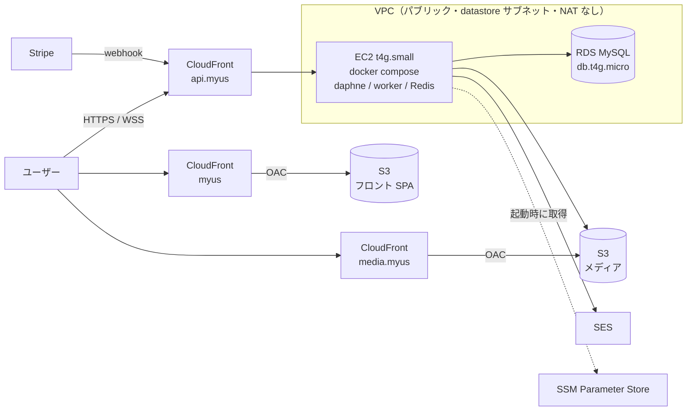
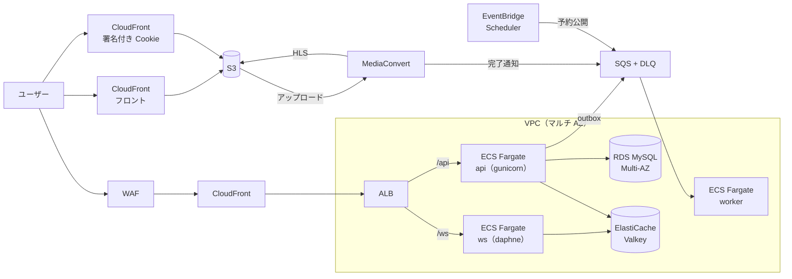
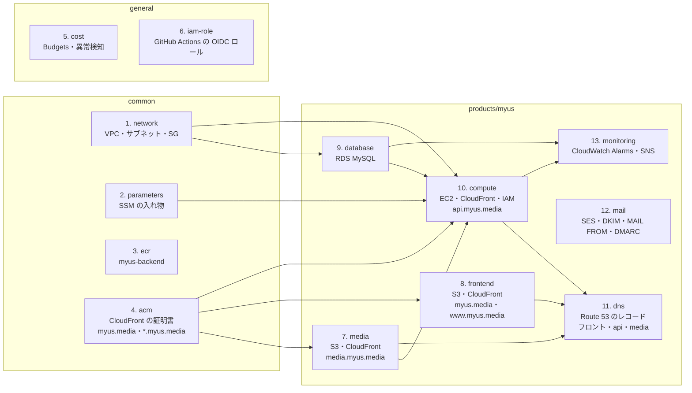
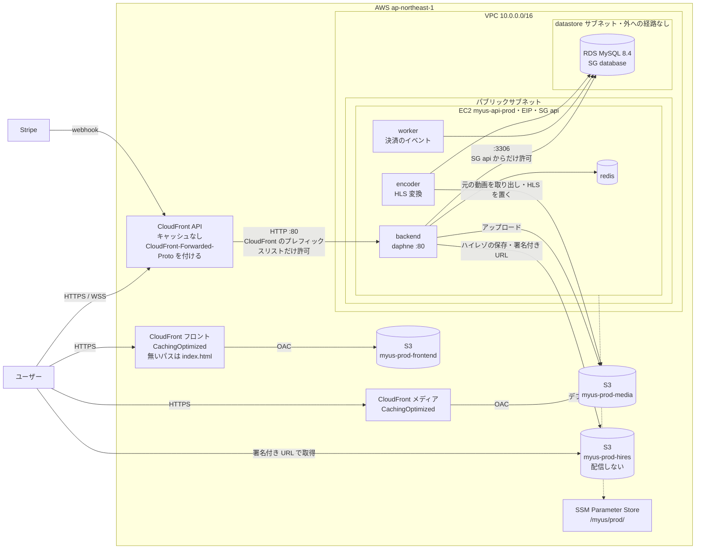
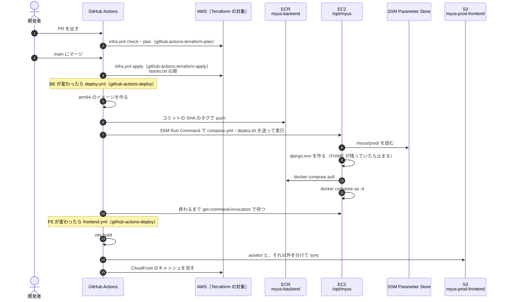
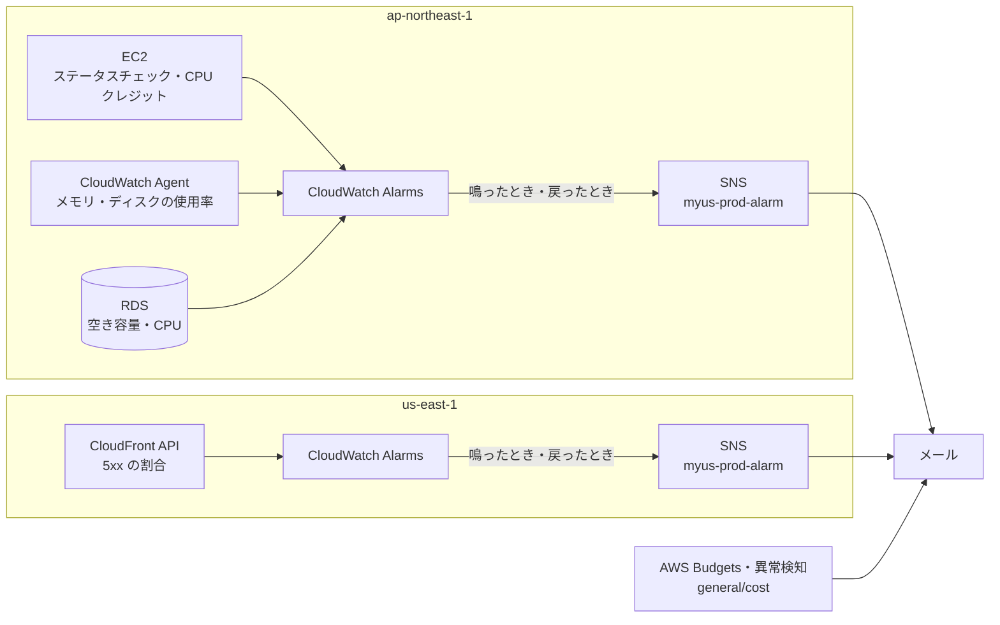

# MyUs インフラ構成（AWS）

本番インフラの構成。Terraform は `infra/aws/` にあり、残りの作業は [roadmap.md](roadmap.md) の「インフラ」にある。

## 前提（現状の構成）

| 領域 | 現状 |
|---|---|
| フロントエンド | Vite + React（SPA）。ビルドしたファイルを S3 に置き、CloudFront から `myus.media`・`www.myus.media` で配信する |
| バックエンド | Django 6.1 + django-ninja。ASGI（daphne）で HTTP と WebSocket（Channels）を処理する。docker-compose では `runserver`（daphne が入っているので ASGI で動く）で `myus_backend:8000` を起動している |
| DB | MySQL 8.4（docker-compose のコンテナ） |
| キャッシュ・Channel Layer | Redis 7（docker-compose のコンテナ） |
| メディア | 開発は `MEDIA_ROOT`（ローカルディスク）、本番（`config/settings/prod.py`）は `django-storages` で S3 に保存し、CloudFront の `MEDIA_DOMAIN` から配信する。接続先は `AWS_STORAGE_BUCKET_NAME`・`AWS_S3_REGION_NAME`・`MEDIA_DOMAIN`（S3 へは EC2 のロールで書くのでキーは要らない）。販売するハイレゾの FLAC は、配信しない別のバケット（`HIRES_BUCKET_NAME`）に置き、5分だけ使える署名付き URL で渡す（`STORAGES["private"]`）。動画は ffmpeg で HLS に変換し、worker は元の動画を一時フォルダに取り出して変換した結果を保存先に上げる（`myus/myus/utils/functions/convert/`） |
| 決済 | Stripe（webhook あり） |
| 非同期処理 | 決済の webhook は記録だけして、`myus_worker`（`process_payment_events`）が DB を定期的に読んで反映する。動画の HLS 変換とオーディオの MP3 への変換・音の大きさの測定は、API がファイルを変換前（`encode_status` が `Encoding`）のまま保存し、`myus_encoder`（`encode_videos`）が DB を定期的に読んで、1回のループで動画とオーディオの両方を処理する |
| メール | 開発は `console.EmailBackend`（送信されない）。本番（`config/settings/prod.py`）は SMTP で送る。接続先は `EMAIL_HOST`・`EMAIL_PORT`・`EMAIL_HOST_USER`・`EMAIL_HOST_PASSWORD`、送信元は `EMAIL_FROM` |
| CI | GitHub Actions。`backend.yml`：mypy・ruff・`manage.py check`・pytest、`frontend.yml`：`pnpm check`・`pnpm test`・ビルド・main では S3 へのデプロイ、`github-actions.yml`：ワークフロー自体の検査（actionlint・zizmor）、`deploy.yml`：本番へのデプロイ、`infra.yml`：Terraform の plan・apply |

---

## 推奨方針

**「フェーズ 1 で小さく安く本番化し、ユーザーが増えたらフェーズ 2 へ移行する」** 二段階の構成にする。

- フロントも **S3 + CloudFront** で配信する。SPA はビルドしたファイルを置くだけなので、外のサービスを増やさずに AWS と Terraform にまとめる
- メディアは最初から **S3 + CloudFront** に置く（あとから移すとデータ移行が大変なため）
- インフラはすべて **Terraform** で管理し、フェーズ 2 への移行もコードの差し替えで行う
- リージョンは **東京（ap-northeast-1）**

---

## フェーズ 1：小さく本番化（月 $40〜60 目安）



### 構成要素

| 用途 | サービス | 内容 |
|---|---|---|
| API・WebSocket | **EC2 t4g.small**（ARM, 2vCPU / 2GB） | 今の docker-compose をほぼそのまま使う。`daphne`（HTTP+WS）、`worker`（決済のイベントの反映）、`encoder`（動画の HLS 変換）、`redis` の 4 コンテナ |
| API の入口 | **CloudFront** + **ACM** | TLS 終端。WebSocket にも対応している。ALB（月 $20 以上）を使わずに HTTPS 化できる。オリジンへのアクセスは CloudFront のマネージドプレフィックスリストに限定する。CloudFront → EC2 は HTTP（80 番）になる（EC2 に証明書を置かないため）。暗号化が要るようになったら ALB か EC2 側の TLS を足す |
| DB | **RDS for MySQL db.t4g.micro**（シングル AZ, gp3 20GB） | 自動バックアップ（7 日）とパッチ適用を任せる。パスワードは Terraform の ephemeral な `random_password` で作り、RDS（`password_wo`）と SSM の `/myus/prod/MYSQL_PASSWORD`（`value_wo`）に同じ値を入れる。state には残らない |
| キャッシュ・Channel Layer | EC2 上の **Redis コンテナ** | フェーズ 1 では ElastiCache を使わずにコストを抑える |
| フロント配信 | **S3** + **CloudFront**（OAC） | `prod/products/myus/frontend`。`myus.media`・`www.myus.media` で配信する。SPA なので、`/` と S3 に無いパスには `index.html` を返す。`frontend.yml` が main でビルドし、`assets/` は長くキャッシュし、それ以外は毎回確かめるようにして S3 に送り、キャッシュを消す |
| メディア保存 | **S3** | `django-storages[s3]` の `S3Storage`（`config/settings/prod.py` の `STORAGES`）。バケットは非公開にし、EC2 のロールで書く |
| メディア配信 | **CloudFront**（OAC） | HLS（`.m3u8` / `.ts`）・画像を配信する。有料コンテンツは **署名付き Cookie** で保護する |
| メール | **SES** | 今の SMTP の設定のまま、接続先を SES の SMTP（`email-smtp.ap-northeast-1.amazonaws.com`）にする（`django-ses` は入れなくてよい）。本番利用申請（サンドボックス解除）が必要。SPF・DKIM・DMARC は Route 53 で設定する。SES は送るだけなので、`myus.media` に届くメールは転送サービスの ImprovMX で運営用の Gmail に転送する（MX は `mail` のスタックが作る） |
| シークレット | **SSM Parameter Store**（SecureString） | Stripe キー・JWT シークレットなど。EC2 の IAM ロールで読み取り、起動時に環境変数へ展開する |
| DNS | **Route 53** | `myus.media`・`www.myus.media`（フロント）・`api.myus.media`・`media.myus.media` |
| 監視 | **CloudWatch**（Agent・Alarms）+ **AWS Budgets** | `prod/products/myus/monitoring` が、EC2 のステータスチェック・CPU クレジット・メモリとディスクの使用率（CloudWatch Agent が送る）、RDS の空き容量・CPU、API の CloudFront の 5xx の割合にアラームを付け、SNS からメールで通知する。CloudFront のメトリクスは us-east-1 にあるので、5xx のアラームと SNS のトピックは us-east-1 にも作る。予算超過は `prod/general/cost` がメールで通知する |
| デプロイ | **GitHub Actions** → **ECR** → EC2（SSM Run Command で `docker compose pull && up -d`） | 認証は OIDC で行う（アクセスキーを使わない）。`.github/workflows/deploy.yml` が arm64 のイメージを buildx で作って ECR に push し、ライブラリの層は GitHub Actions のキャッシュで使い回す。`compute/deploy/` の `compose.yml`・`deploy.sh` を EC2 に送って実行する。`deploy.sh` は SSM の `/myus/prod/` から `django.env` を作ってから起動する |

### HLS 変換・MP3 変換の分離

- アップロードされたら、API はファイルを S3 に置いて **動画・オーディオを変換前のまま保存するだけ**にする
- `encoder` コンテナ（`encode_videos`）が変換前の動画を S3 から一時フォルダに取り出して ffmpeg で変換し、結果を S3 に置く
- オーディオも同じ `encoder` コンテナが処理する。S3 から一時フォルダに取り出し、ビットレートを確かめ、MP3 以外は MP3 に変換して S3 に置き、音の大きさを測る。変換したときは、`Done` に保存したあとで元のファイルを S3 から消す
- 同じ EC2 内でも、コンテナ（プロセス）を分けて CPU 制限（`cpus:`）をかければ API への影響を抑えられる
- メモリが 2GB しかないので、コンテナごとにメモリの上限（`mem_limit`）を付け、EC2 に 2GB のスワップを置いている。1 つのコンテナが使いすぎても、そのコンテナだけが落ちて `restart: always` で上がり直し、OS ごと固まらない

### コスト目安（東京リージョン・月額）

| 項目 | 目安 |
|---|---|
| EC2 t4g.small + EBS 30GB | $18 |
| パブリック IPv4（1 個） | $4 |
| RDS db.t4g.micro + 20GB | $20 |
| S3（100GB） | $3 |
| CloudFront | 無料枠（月 1TB）内なら $0 |
| Route 53・SES・SSM・CloudWatch | $2〜5 |
| **合計** | **約 $45〜50** |

※ 料金は目安。正確な金額は AWS Pricing Calculator で確認する。

---

## フェーズ 2：成長期の構成（月 $200〜300 目安）

次のどれかに当てはまったら移行する。

- EC2 1 台の CPU・メモリが常に逼迫している（特に HLS 変換）
- ダウンタイムを許容できなくなった（有料プランのユーザーが増えたなど）
- WebSocket の同時接続数が増えた



### フェーズ 1 からの変更点

| 項目 | フェーズ 1 | フェーズ 2 |
|---|---|---|
| 実行環境 | EC2 1 台 | **ECS Fargate**（`api` / `ws` / `worker` の 3 サービス、オートスケール） |
| 入口 | CloudFront → EC2 | CloudFront + **WAF** → **ALB**（パスで `api` / `ws` に振り分け） |
| DB | RDS シングル AZ | RDS **Multi-AZ**（さらに伸びたら Aurora MySQL Serverless v2） |
| Redis | EC2 上のコンテナ | **ElastiCache for Valkey** |
| 非同期処理 | worker が DB を定期的に読む（決済のイベントは `myus_worker`、動画の変換は `myus_encoder`） | **SQS**（DLQ 付き）→ `worker` |
| 動画変換 | ffmpeg（`encoder` コンテナ） | **MediaConvert**（S3 へのアップロードをトリガーに実行、ABR 対応） |
| 予約公開（`publish_at`） | 定期処理は持たない。一覧・詳細・通知を取るときに `publish_at` が今より前のものだけに絞る | **EventBridge Scheduler**（公開の瞬間に通知を送るなど、その時点で処理が要るようになったら） |
| 不適切コンテンツ対策 | なし | **Rekognition** のモデレーション（任意） |

### NAT Gateway を避ける工夫

NAT Gateway は 1 個で月 $45 以上かかるため、次のどちらかで回避する。

- Fargate タスクをパブリックサブネットに置き、セキュリティグループで ALB からの通信だけを許可する
- プライベートサブネットに置く場合は、S3（Gateway 型・無料）・ECR・SSM・SQS・CloudWatch Logs の VPC エンドポイントを作る

Stripe API など外部への通信が必要なので、プライベートサブネットにする場合は最終的に NAT が必要になる。フェーズ 2 の初期はパブリックサブネットに置く方針をおすすめする。

---

## IaC（Terraform）

### ディレクトリ構成

rcmr-studio の `infra/aws` と同じ形にする。ディレクトリ 1 つが 1 つの state（スタック）になる。

```
infra/
├── .gitignore
└── aws/
    ├── modules/              # 使い回すモジュール（cost・github-actions・cloudfront-oac など）
    └── prod/
        ├── variables.tf      # params（環境の共通パラメータ）
        ├── outputs.tf
        ├── general/          # アカウント全体にかかるもの（cost・iam-role）
        ├── common/           # 環境の共通基盤（network・parameters・ecr・acm）
        └── products/
            └── myus/         # MyUs のリソース（media・database・compute・dns・mail・monitoring）
```

- 環境は `prod` の 1 つで始める。`stg` は必要になってから `prod` と同じ形で足す
- 各スタックは `module "params" { source = "../../" }`（深さに合わせる）で params を読み、`local.p = module.params.params` として使う
- ほかのスタックの値は `terraform_remote_state` で outputs から読む

### 運用ルール

- state は S3（`terraform-myus-prod`）に保存し、`key` はスタックのパス（例：`general/cost/terraform.tfstate`）にする。ロックには `use_lockfile = true` を使う（DynamoDB は不要）
- provider のバージョンは固定する（`version = "6.x.y"`）
- provider の `default_tags` に `Env`・`Product`・`ManagedBy = "terraform"` を付ける
- AWS CLI のプロファイルは `myus-prod`（params の `profile`）
- 公開リポジトリなので、メールアドレスなど公開したくない値は params に書かず、スタックの `variable` にして `terraform.tfvars`（Git 管理外）か `TF_VAR_<名前>` で渡す
- `.github/workflows/infra.yml` で、PR では全スタックの `fmt`・`validate`・`plan`、main にマージされたら全スタックの `apply` を流す。`infra/` を変えていなくても、Actions の画面から main で手動実行すれば `apply` を流せる（最初の構築など）。plan の結果はジョブのログで見る。スタックは `infra/aws/prod/stacks.txt` の順に plan・apply する（ほかのスタックの outputs を読むスタックは、読まれる側より後に書く）。スタックを足したら `stacks.txt` にも足す（足し忘れは `check` で止まる）
- 公開リポジトリは Actions のログも公開されるので、公開したくない `variable` には `sensitive = true` を付けて plan に出さない
- コンソールでの手作業による変更は禁止する。`infra.yml` が毎週月曜 9:00（JST）に main で全スタックの `plan` を流し、コードと AWS に差分があればジョブを失敗させる（GitHub の失敗の通知で気づく）。plan のロール（`github-actions-terraform-plan`）は、そのために main からも使えるようにしている

### コード化しないもの（手作業）

| 項目 | 対応 |
|---|---|
| AWS アカウントの作成・ルートユーザーの MFA・請求設定 | 最初に一度だけ手作業で行う |
| state 用の S3 バケット（`terraform-myus-prod`） | 手作業で作り、バージョニングを有効にする |
| 環境変数の値 | 入れ物（`prod/common/parameters` の `/myus/prod/<名前>`）だけを Terraform で `FIXME` の値で作り、本当の値は `aws ssm put-parameter --overwrite` で入れる。Git にも state にも残らない（`value_wo`）。DB のパスワードは `prod/products/myus/database` が作って `/myus/prod/MYSQL_PASSWORD` に入れる。DB の接続先・メディアのバケットなど Terraform で決まる値は `prod/products/myus/compute` が `/myus/prod/` に入れる |
| SES の本番利用申請・サービスクォータの引き上げ | AWS に申請する |
| ドメインの購入 | 手作業で行う（DNS レコードはコードで管理する） |
| DB・S3 のデータ | バックアップで守る（RDS の自動バックアップ、S3 のバージョニング） |

---

## 構成図

Terraform で作るものを、スタックの依存・リクエストの流れ・デプロイの流れ・監視の流れの 4 つに分けて描く。ドメイン関連（ACM・Route 53・SES）はまだ無いので描いていない。

### スタックの依存と apply の順

矢印は `terraform_remote_state` で outputs を読む向き（読まれる側 → 読む側）。apply は `infra/aws/prod/stacks.txt` の番号の順に流れるので、読まれる側が先に作られる。



`ecr`・`cost`・`iam-role` はほかのスタックの outputs を読まない。`iam-role` のデプロイ用のロールは、ECR のリポジトリ・EC2・フロントのバケットを名前（`myus-backend`・`myus-api-prod`・`myus-prod-frontend`）で指している。

### リクエストの流れ



### デプロイの流れ



### DB のスキーマの変更

`myus/myus/db/migrations/` は Git の管理外なので、デプロイではマイグレーションを流さない。本番の DB は次の手順で手作業で変える。EC2 には SSM のセッションで入り、`/opt/myus` で行う。

1. 最初のデプロイ：空の DB に、使い捨てのコンテナでマイグレーションを作って流す。イメージの中は `app` ユーザーでは書けないので root で動かす。作ったファイルはコンテナと一緒に消える

   ```bash
   docker compose run --rm -u root backend sh -c "python manage.py makemigrations myus && python manage.py migrate"
   ```

   公開するまでは、本番に本当のデータが無いので、モデルを変えても SQL は書かずに手元の `0001_initial.py` を作り直してよい。そのときは本番の DB を空にしてから 1 をやり直す。公開したあとは 2 の SQL のやり方に切り替える

   ```bash
   docker compose stop backend worker encoder
   echo "DROP DATABASE myus; CREATE DATABASE myus;" | docker compose run --rm -T backend python manage.py run_sql
   docker compose run --rm -u root backend sh -c "python manage.py makemigrations myus && python manage.py migrate"
   docker compose up -d
   ```

2. その後のモデルの変更：PR に書いた `sqlmigrate` の SQL を、デプロイの前に `run_sql` で流す。SQL は標準入力で渡し、1文ずつ流す。表を消す・列を消す変更は、新しいコードが使わなくなってから流す

   ```bash
   docker compose exec -T backend python manage.py run_sql < change.sql
   ```

3. 流したら、その PR に「本番に流した」と日時をコメントで残す。どの SQL を流したかの記録は PR で持つ

### 監視の流れ

CloudFront のメトリクスは us-east-1 にしか無く、アラームの通知先は同じリージョンの SNS でないといけないので、SNS のトピックを東京と us-east-1 の 2 つ作っている。どちらも同じメールアドレスに送る。



---

## 移行ステップ

進め方と残りの作業は [roadmap.md](roadmap.md) の「インフラ」にある。
