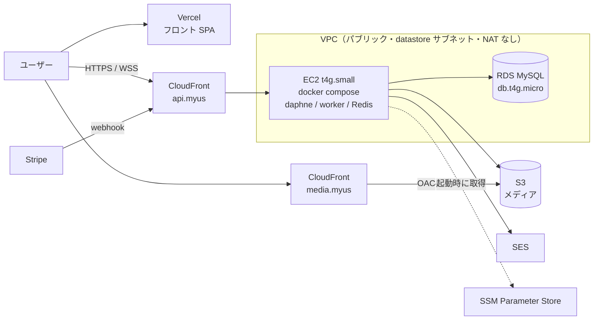
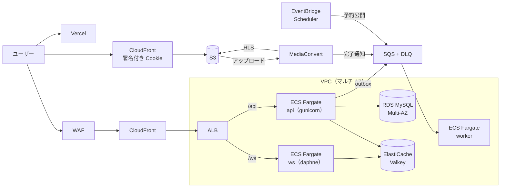

# MyUs インフラ構成案（AWS）

2026-11-08 時点のコードベースをもとにした、本番インフラの推奨構成。

## 前提（現状の構成）

| 領域 | 現状 |
|---|---|
| フロントエンド | Vite + React（SPA）。`frontend/vercel.json` で Vercel にデプロイ |
| バックエンド | Django 6.1 + django-ninja。ASGI（daphne）で HTTP と WebSocket（Channels）を処理する。docker-compose では `runserver`（daphne が入っているので ASGI で動く）で `myus_backend:8000` を起動している |
| DB | MySQL 8.4（docker-compose のコンテナ） |
| キャッシュ・Channel Layer | Redis 7（docker-compose のコンテナ） |
| メディア | `MEDIA_ROOT`（ローカルディスク）に保存。動画・音楽は ffmpeg で HLS に変換（`myus/myus/utils/functions/convert/`） |
| 決済 | Stripe（webhook あり） |
| 非同期処理 | 決済の webhook は記録だけして、`myus_worker`（`process_payment_events`）が DB を定期的に読んで反映する。動画の HLS 変換は、API が変換ジョブ（`encode_job`）を積むだけにし、`myus_encoder`（`process_encode_jobs`）が取り出して変換する |
| メール | 開発は `console.EmailBackend`（送信されない）。本番（`config/settings/prod.py`）は SMTP で送る。接続先は `EMAIL_HOST`・`EMAIL_PORT`・`EMAIL_HOST_USER`・`EMAIL_HOST_PASSWORD`、送信元は `EMAIL_FROM` |
| CI | GitHub Actions（デプロイなし）。`backend.yml`：mypy・ruff・`manage.py check`・pytest、`frontend.yml`：`pnpm check`・`pnpm test`・ビルド、`github-actions.yml`：ワークフロー自体の検査（actionlint・zizmor） |

### 本番化する前に解決すべき課題

1. **メディアがローカルディスクにある**: サーバーの入れ替えやスケールアウトでファイルが消える・共有できない
2. **HLS 変換の worker がローカルディスクを読み書きする**: 変換は `myus_encoder` に分けたが、元の動画も変換した結果も `MEDIA_ROOT` にある。S3 に移すときに worker も合わせる
3. **メールの送信元が決まっていない**: 本番は SMTP で送る設定になったが、送る SMTP サーバー（Gmail・SES の SMTP など）と送信元のアドレス・ドメインの認証（SPF・DKIM）を用意する必要がある
4. **シークレットが `myus/envs/*.env` にある**: 本番では安全な保管場所が必要。`envs/sample.env` の `AWS_*` の項目は、まだどこからも使われていない（`django-storages`・`django-ses` は未導入）

---

## 推奨方針

**「フェーズ 1 で小さく安く本番化し、利用者が増えたらフェーズ 2 へ移行する」** 二段階の構成にする。

- フロントは **Vercel を継続**する（SPA の配信は Vercel で十分で、移行するメリットが小さい）
- メディアは最初から **S3 + CloudFront** に置く（あとから移すとデータ移行が大変なため）
- インフラはすべて **Terraform** で管理し、フェーズ 2 への移行もコードの差し替えで行う
- リージョンは **東京（ap-northeast-1）**

---

## フェーズ 1：小さく本番化（月 $40〜60 目安）



### 構成要素

| 用途 | サービス | 内容 |
|---|---|---|
| API・WebSocket | **EC2 t4g.small**（ARM, 2vCPU / 2GB） | 今の docker-compose をほぼそのまま使う。`daphne`（HTTP+WS）、`worker`（HLS 変換・outbox 処理）、`redis` の 3 コンテナ |
| API の入口 | **CloudFront** + **ACM** | TLS 終端。WebSocket にも対応している。ALB（月 $20 以上）を使わずに HTTPS 化できる。オリジンへのアクセスは CloudFront のマネージドプレフィックスリストに限定する |
| DB | **RDS for MySQL db.t4g.micro**（シングル AZ, gp3 20GB） | 自動バックアップ（7 日）とパッチ適用を任せる。パスワードは `manage_master_user_password` で Secrets Manager に自動生成させる |
| キャッシュ・Channel Layer | EC2 上の **Redis コンテナ** | フェーズ 1 では ElastiCache を使わずにコストを抑える |
| メディア保存 | **S3** | `django-storages[s3]` を導入して `STORAGES` を切り替える。バケットは非公開にする |
| メディア配信 | **CloudFront**（OAC） | HLS（`.m3u8` / `.ts`）・画像を配信する。有料コンテンツは **署名付き Cookie** で保護する |
| メール | **SES** | 今の SMTP の設定のまま、接続先を SES の SMTP（`email-smtp.ap-northeast-1.amazonaws.com`）にする（`django-ses` は入れなくてよい）。本番利用申請（サンドボックス解除）が必要。SPF・DKIM・DMARC は Route 53 で設定する |
| シークレット | **SSM Parameter Store**（SecureString） | Stripe キー・JWT シークレットなど。EC2 の IAM ロールで読み取り、起動時に環境変数へ展開する |
| DNS | **Route 53** | `myus.xxx`（Vercel）・`api.myus.xxx`・`media.myus.xxx` |
| 監視 | **CloudWatch**（Agent・Logs・Alarms）+ **AWS Budgets** | CPU・ディスク・RDS の空き容量・5xx のアラーム。予算超過はメールで通知する |
| デプロイ | **GitHub Actions** → **ECR** → EC2（SSM Run Command で `docker compose pull && up -d`） | 認証は OIDC で行う（アクセスキーを使わない） |

### HLS 変換の分離

- アップロードされたら、API はファイルを S3 に置いて **変換ジョブを DB（outbox）に積むだけ**にする
- `worker` コンテナがジョブを取り出して ffmpeg で変換し、結果を S3 に置く
- 同じ EC2 内でも、コンテナ（プロセス）を分けて CPU 制限（`cpus:`）をかければ API への影響を抑えられる

### コスト目安（東京リージョン・月額）

| 項目 | 目安 |
|---|---|
| EC2 t4g.small + EBS 30GB | $18 |
| パブリック IPv4（1 個） | $4 |
| RDS db.t4g.micro + 20GB | $20 |
| S3（100GB） | $3 |
| CloudFront | 無料枠（月 1TB）内なら $0 |
| Route 53・SES・SSM・CloudWatch | $2〜5 |
| **合計** | **約 $45〜50** |

※ 料金は目安。正確な金額は AWS Pricing Calculator で確認する。

---

## フェーズ 2：成長期の構成（月 $200〜300 目安）

次のどれかに当てはまったら移行する。

- EC2 1 台の CPU・メモリが常に逼迫している（特に HLS 変換）
- ダウンタイムを許容できなくなった（有料会員が増えたなど）
- WebSocket の同時接続数が増えた



### フェーズ 1 からの変更点

| 項目 | フェーズ 1 | フェーズ 2 |
|---|---|---|
| 実行環境 | EC2 1 台 | **ECS Fargate**（`api` / `ws` / `worker` の 3 サービス、オートスケール） |
| 入口 | CloudFront → EC2 | CloudFront + **WAF** → **ALB**（パスで `api` / `ws` に振り分け） |
| DB | RDS シングル AZ | RDS **Multi-AZ**（さらに伸びたら Aurora MySQL Serverless v2） |
| Redis | EC2 上のコンテナ | **ElastiCache for Valkey** |
| 非同期処理 | DB の outbox をワーカーがポーリング | outbox → **SQS**（DLQ 付き）→ `worker` |
| 動画変換 | ffmpeg（`worker` コンテナ） | **MediaConvert**（S3 へのアップロードをトリガーに実行、ABR 対応） |
| 予約公開（`publish_at`） | 定期処理は持たない。一覧・詳細・通知を取るときに `publish_at` が今より前のものだけに絞る | **EventBridge Scheduler**（公開の瞬間に通知を送るなど、その時点で処理が要るようになったら） |
| 不適切コンテンツ対策 | なし | **Rekognition** のモデレーション（任意） |

### NAT Gateway を避ける工夫

NAT Gateway は 1 個で月 $45 以上かかるため、次のどちらかで回避する。

- Fargate タスクをパブリックサブネットに置き、セキュリティグループで ALB からの通信だけを許可する
- プライベートサブネットに置く場合は、S3（Gateway 型・無料）・ECR・SSM・SQS・CloudWatch Logs の VPC エンドポイントを作る

Stripe API など外部への通信が必要なので、プライベートサブネットにする場合は最終的に NAT が必要になる。フェーズ 2 の初期はパブリックサブネットに置く方針をおすすめする。

---

## IaC（Terraform）

### ディレクトリ構成

rcmr-studio の `infra/aws` と同じ形にする。ディレクトリ 1 つが 1 つの state（スタック）になる。

```
infra/
├── .gitignore
└── aws/
    ├── modules/              # 使い回すモジュール（cost・github-actions・cloudfront-oac など）
    └── prod/
        ├── variables.tf      # params（環境の共通パラメータ）
        ├── outputs.tf
        ├── general/          # アカウント全体にかかるもの（cost・iam-role）
        ├── common/           # 環境の共通基盤（network・parameters・ecr・acm）
        └── products/
            └── myus/         # MyUs のリソース（media・database・compute・dns・mail・monitoring）
```

- 環境は `prod` の 1 つで始める。`stg` は必要になってから `prod` と同じ形で足す
- 各スタックは `module "params" { source = "../../" }`（深さに合わせる）で params を読み、`local.p = module.params.params` として使う
- ほかのスタックの値は `terraform_remote_state` で outputs から読む

### 運用ルール

- state は S3（`terraform-myus-prod`）に保存し、`key` はスタックのパス（例：`general/cost/terraform.tfstate`）にする。ロックには `use_lockfile = true` を使う（DynamoDB は不要）
- provider のバージョンは固定する（`version = "6.x.y"`）
- provider の `default_tags` に `Env`・`Product`・`ManagedBy = "terraform"` を付ける
- AWS CLI のプロファイルは `myus-prod`（params の `profile`）
- 公開リポジトリなので、メールアドレスなど公開したくない値は params に書かず、スタックの `variable` にして `terraform.tfvars`（Git 管理外）か `TF_VAR_<名前>` で渡す
- `.github/workflows/infra.yml` で、PR では全スタックの `fmt`・`validate`・`plan`、main にマージされたら全スタックの `apply` を流す。plan の結果はジョブのログで見る。スタックはパスの順（common → general → products）に apply する
- 公開リポジトリは Actions のログも公開されるので、公開したくない `variable` には `sensitive = true` を付けて plan に出さない
- コンソールでの手作業による変更は禁止する。定期的に `plan` を実行してドリフトを検知する
- Vercel のドメイン・環境変数も Terraform の Vercel プロバイダで同じリポジトリから管理する

### コード化しないもの（手作業）

| 項目 | 対応 |
|---|---|
| AWS アカウントの作成・ルートユーザーの MFA・請求設定 | 最初に一度だけ手作業で行う |
| state 用の S3 バケット（`terraform-myus-prod`） | 手作業で作り、バージョニングを有効にする |
| シークレットの値 | 入れ物（パラメータ名）だけを Terraform で作り、値は CLI で投入する。Git には入れない |
| SES の本番利用申請・サービスクォータの引き上げ | AWS に申請する |
| ドメインの購入 | 手作業で行う（DNS レコードはコードで管理する） |
| DB・S3 のデータ | バックアップで守る（RDS の自動バックアップ、S3 のバージョニング） |

---

## 移行ステップ

進め方と残りの作業は [roadmap.md](roadmap.md) の「インフラ」にある。
