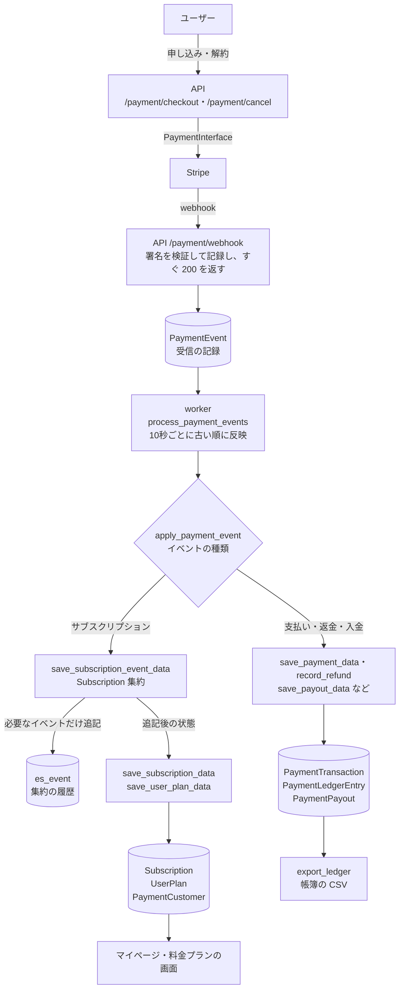

# MyUs - 総合メディアプラットフォーム SNS 設計書

## サービス概要

MyUsは「My Idea Know Us」を由来とする、YouTube型UIを採用した総合メディアプラットフォームSNSです。動画、音楽、漫画、画像、ブログ、チャットなど多様なメディアコンテンツの投稿・共有が可能で、リアルタイム通信機能も備えた統合型プラットフォームです。

## 主要機能

### コンテンツ投稿機能
- **Video**: 動画アップロード
- **Music**: 音楽アップロード
- **Blog**: リッチテキストエディタ対応ブログ。有料部分を付けて記事ごとに売れる（Standard 以上）
- **Comic**: 漫画投稿
- **Picture**: 画像投稿
- **Chat**: リアルタイムチャット

### ユーザー機能
- 認証システム
- プロフィール管理
- マイページ機能
- 通知設定
- 料金プラン管理
- プレイリスト（音楽を集めて並べる）
- シリーズ（チャンネルの同じ種類の投稿をまとめる）
- 個別広告の掲載（数はプランで決まる）
- 有料記事の販売（売上を受け取る口座の登録。Stripe Connect）

### インタラクション機能
- いいね機能
- コメント・リプライ
- フォロー/フォロワー機能
- チャンネル登録
- 検索機能
- 通知システム

## システム設計図

### データモデル構造

```
【User System】
User
  ├─ Profile (個人情報)
  ├─ MyPage (公開情報)
  ├─ UserNotification
  ├─ UserPlan
  └─ Channel
        └─ is_default

【Channel System】
Channel
  ├─ owner
  ├─ avatar
  ├─ name
  ├─ description
  ├─ is_default
  └─ メディアコンテンツ
        ├─ videos
        ├─ musics
        ├─ comics
        ├─ pictures
        ├─ blogs
        └─ chats

【Media Contents】
※ 全メディアは Channel に紐づく

Video
  ├─ channel
  ├─ 動画ファイル、変換ファイル、サムネイル、変換の状態
  └─ カテゴリー、ハッシュタグ、いいね、閲覧数

Music
  ├─ 音楽ファイル、ジャケット画像、歌詞
  └─ MusicHires (販売するハイレゾ。1曲に1つ)

Playlist (ユーザーが作る音楽の並び)
  ├─ PlaylistMusic
  └─ 曲の順序管理、公開・非公開

Blog

Comic
  ├─ ComicPage
  └─ ページ順序管理

Picture
Chat

Series (チャンネルの同じ種類の投稿をまとめる。メディアとは独立)
  └─ SeriesMedia (media_type・object_id・並び順)

【Interaction System】
Comment
  ├─ 階層構造
  └─ いいね機能付き

Message
  ├─ スレッド対応
  └─ TipTap エディタ対応

Follow
Subscribe (チャンネル登録)
Notification
  └─ 確認済み/削除済み管理

【Payment】（詳しくは「決済システム」）
PaymentEvent (決済会社から届いたイベント)
PaymentCustomer
  ├─ Subscription
  └─ PaymentTransaction
       ├─ PaymentLedgerEntry
       └─ Purchase (誰がどの商品を買ったか)
Product (売る物の種類と ID・値段。記事の有料部分・音楽のハイレゾ)
  └─ Purchase
PaymentSeller (商品を売る人の受け取り口座)
PaymentPayout
EsEvent / EsOutbox (集約のイベント)

【Master & Others】
Category
HashTag
NgWord
SearchTag (ユーザー検索タグ)
AccessLog
Advertise
※ 料金プランはテーブルではなく `myus/domain/payment/plan.py` の定数
```

## データモデル詳細

### ユーザーシステム

#### User
- 認証情報
- アバター画像
- アクティブ状態、スタッフ権限

#### Profile
- 個人情報
- 連絡先
- 住所情報
- 自己紹介文

#### MyPage
- 公開プロフィール情報
- バナー画像
- フォロワー/フォロー数カウント
- 広告表示設定
- Google Tag Manager ID

#### UserNotification
- メディアタイプ別通知設定
- アクション別通知設定

#### UserPlan
- 料金プラン情報（決済会社の顧客 ID・サブスクリプションは `PaymentCustomer`・`Subscription` に持つ）
- 支払い状態
- プラン開始/終了日

### チャンネルシステム

#### Channel
YouTubeのチャンネルと同様の概念。1人のユーザーが複数のチャンネルを所有でき、各チャンネルにメディアコンテンツを投稿する。

- **owner**: チャンネル所有者
- **ulid**: ユニーク識別子
- **avatar**: チャンネルアバター画像
- **name**: チャンネル名
- **description**: チャンネル説明
- **is_default**: デフォルトチャンネルフラグ
  - ユーザー作成時に1つのデフォルトチャンネルが自動生成される
  - メディア投稿時、明示的な指定がない場合はデフォルトチャンネルに投稿
- **created/updated**: 作成/更新日時

#### チャンネルの利用フロー
1. アカウント登録時にデフォルトチャンネルが自動作成される
2. メディア投稿時、ユーザーのデフォルトチャンネル（`is_default=True`）を取得
3. メディアはチャンネルに紐づいて作成される
4. メディア一覧・詳細では `channel.owner` から作者情報を取得

### メディアコンテンツ

#### 共通機能（MediaModel）
- **channel**: 所属チャンネル
- **ulid**: ユニーク識別子
- タイトル、説明文
- カテゴリー、ハッシュタグ
- いいね機能
- 閲覧数カウント
- 公開/非公開設定
- 作成/更新日時

#### Video（動画）
- 動画ファイル、変換済みファイル
- サムネイル画像
- 変換の状態（`encode_status`。`Encoding`・`Done`・`Failed`）
- 検索対応

動画は変換前（`Encoding`）のまま保存し、worker（`encode_videos`。docker-compose の `myus_encoder`）が古い順に ffmpeg で HLS に変換する。元の動画を一時フォルダに取り出して変換し、できた `.m3u8`・`.ts`・`.mp4` を保存先に上げて `Done` にする。続けて3回失敗したら壊れたファイルとみなして `Failed` にし、それ以上は試さない。公開の一覧・詳細には `Done` の動画だけを出す。`Failed` の動画は、管理画面の一覧に「変換できませんでした」と出し、編集で動画のファイルを上げ直すと `Encoding` に戻る。

#### Music（音楽）
- 音楽ファイル。編集画面で差し替えられ、差し替えたときは曲の大きさも測り直す
- アップロードのときに ffprobe で音声の形式とビットレートを読む（`utils/functions/convert/audio_converter.py`）
  - MP3 は変換せずにそのまま保存する。変換し直すと音が悪くなるため
  - MP3 以外は、WAV・FLAC・AAC・Ogg などどれも、320kbps の MP3 に変換する。音を削る形式を変換し直すときも、高いビットレートのほうが失う音が少ないため
  - WAV・AIFF（`pcm_*`）・FLAC のように音を削らない形式を除き、ビットレートが 192kbps より低いものは上げ直してもらう（`error.musicBitRateLow`）。測った値は作ったときの値より少し低く出るので、180kbps を境にしている
- ジャケット画像（無ければチャンネルのアバターを出す）
- ハイレゾの販売。再生用の音楽とは別に、販売用の FLAC を編集画面で上げると、その曲が有料の販売データになる（`MusicHires`）
  - 売れるのは Standard 以上のプランで、売上を受け取る口座の登録が済んだ人。通貨は投稿者の国から決める
  - 音質は 24bit で、サンプリングレートは 48kHz〜192kHz。アップロードのときに ffprobe で読んで保存し、決まりは `domain/media/hires/validation.py` が保存の前に確かめる
  - 値段は 300〜600。ドルは 3.00〜6.00。値段は `Product` に持つ
  - 購入した人がいるときは、販売をやめることも、曲を削除することもできない（`error.saleStopPurchased`・`error.deletePurchased`）
  - ファイルは変換せずに、公開しない置き場（`STORAGES["private"]`）に置く。開発は `myus/private`、本番は別の S3 のバケット
  - 詳細（`GET /media/music/{ulid}`）は、`hires`（サンプリングレート・ビット深度。売っていなければ null）・`product`（`ulid`・`price`）・`is_purchased` を返す。ファイルの場所は返さない
  - ダウンロード（`GET /media/music/{ulid}/hires`・`get_music_hires_url`）：投稿者と購入した人にだけ、5分（`PRIVATE_URL_EXPIRE`）だけ使える URL を返す。購入していなければ `error.hiresNotPurchased`
  - 編集画面の「ハイレゾの販売」（`pages/manage/music/HiresSale`）：FLAC の先頭の情報（STREAMINFO）を読んで、24bit・48kHz〜192kHz かと値段の範囲を確かめてから送る（`utils/functions/hires.ts`）。大きなファイルなので、この送信だけタイムアウトを30分（`LARGE_UPLOAD_TIMEOUT_MS`）にする。Standard 未満や口座が無いときは案内（`widgets/SellerHint`）を出す
  - 詳細画面：投稿者と購入した人には「ハイレゾをダウンロード」、ほかの人には購入の枠（`widgets/Paywall`。記事の有料部分と同じ部品）を出す
  - 本番は S3 の署名付き URL。開発は `config/storages.py` の `SignedFileSystemStorage` が署名付きの URL（`/private/{token}`）を作り、DEBUG のときだけの `serve_private` が署名と期限を確かめて渡す
- 再生時間は DB に持たない。一覧のカードにカーソルを乗せたとき・再生したときに、ブラウザが曲の情報（metadata）だけを読んで出す。再生中の曲のカードは出したままにする
- 一覧のカードのジャケットを押すと、画面の下のミニプレイヤーで再生する。ページを移っても再生を続け、曲が終わったら同じ一覧の次の曲に進む（`MusicPlayerProvider`・`widgets/MiniPlayer`）
- 詳細のプレイヤーの横と、一覧のカードにカーソルを乗せると出る「＋」から、プレイリストに足す。その場で新しいプレイリストも作れる（`widgets/PlaylistAdd`）
- 歌詞テキスト。行の頭に `[mm:ss.xx]`（LRC の書き方）の時刻があれば、詳細画面で再生に合わせて今の行を光らせて自動でスクロールし、行を押すとそこから再生する（`widgets/Lyric`・`utils/functions/lyric.ts`）。時刻が無ければそのまま出す
- 時刻は、音楽の作成・編集画面の「歌詞の時刻を付ける」のモーダル（`pages/manage/music/LyricEditor`）で、曲を再生しながら行ごとに記録できる。歌詞と時刻もその場で直せ、±0.1 秒の調整・同期の見え方の確認ができる。「反映する」で歌詞の欄に戻し、フォームの保存で保存する。作成画面では選んだ音楽ファイルをそのまま再生する
- 曲ごとの音の大きさの違いをならす。アップロードのときに ffmpeg の loudnorm で大きさ（LUFS）を測り、-14 LUFS より大きい曲だけ、その差を `gain`（dB。0〜-20）に入れる。再生するときは、音量にその分を掛けて下げる（`utils/functions/volume.ts` の `gainVolume`）。ファイルは書き換えない。小さい曲を上げることはしない
- 検索対応

#### Playlist（プレイリスト）
- ユーザーが音楽を集めて並べる。曲の並びは `PlaylistMusic` の `sequence` で持つ
- 公開・非公開をプレイリストごとに選ぶ。非公開は作った人だけが見られる
- 1つのプレイリストに入る曲は200曲まで。同じ曲は1回だけ入る
- 作る・曲を足す・編集するのは有料プラン（Basic 以上。`Plan.is_playlist`）だけ。解約したあとも、見る・再生・曲を外す・削除はできる
- 公開されていない曲は、曲の持ち主以外には出さない
- 説明文は1000文字まで。サムネイルは中の曲の画像から選び、その画像を `image` に入れる。選んでいないときは1曲目の画像にする
- 名前・説明文・サムネイル・公開・曲の並びは `PUT /media/playlist/{ulid}` でまとめて保存し、曲を1つ足すのは `POST /media/playlist/{ulid}/music`
- 自分のプレイリストはサイドメニューの「プレイリスト」（`/menu/playlist`）、中身は `/menu/playlist/$ulid`。中身では「すべて再生」でミニプレイヤーに流し、持ち主は名前・説明文・サムネイル・公開・曲の並び替え・削除を編集できる
- ユーザーページの「投稿」の右の「プレイリスト」に、その人の公開プレイリストだけを出す

#### Comic（漫画）
- メイン画像
- ComicPageによる複数ページ管理
- ページ順序制御

#### Picture（画像）
- 画像ファイル
- シンプルな画像投稿機能

#### Blog（ブログ）
- リッチテキスト
- プレーンテキスト
- サムネイル画像
- 有料部分（`paid_text`）と値段。有料部分があれば `Product` を作り、値段はそこに持つ。有料部分を空にすると `Product` を消す
  - 付けられるのは Standard 以上のプラン（`Plan.is_paid_content`）で、売り手の口座の登録が済んでいる人だけ。有料部分か値段を変えるときだけ確かめるので、プランを下げても、付けてある有料部分はそのまま売れ、ほかの項目の編集もできる
  - 値段は 300〜50,000 で、通貨は付けたときの投稿者の国/地域から決める（円か米ドル。ドルはセント）。値段の範囲は `domain/payment/product/validation.py` が確かめる。有料部分と値段の組み合わせの誤りは FE で出す
  - 購入した人がいるときは、有料部分を空にすることも、記事を削除することもできない（`error.saleStopPurchased`・`error.deletePurchased`）
  - 詳細（`GET /media/blog/{ulid}`）は、投稿者本人と買った人にだけ `paid_text` を返す。ほかの人には空にして、`product`（`ulid`・`price`。売っていなければ null）と `is_purchased` を返す。一覧には有料部分を入れない
  - 買う：`POST /payment/checkout/product` に `product.ulid` を送る（「Product」の節）

#### Product
- 売る物の共通の表。売る人（`seller`）・種類（`product_type`：`Blog`・`MusicHires`）・売る物の ID（`object_id`：記事の id・音楽の id）・値段（`price`・`currency`）を持つ。種類と売る物の ID の組で一意。行があれば販売中
- 売る物の中身は種類ごとの表に置く。記事の有料部分は `Blog.paid_text`、ハイレゾのファイルは `MusicHires.file`
- 売る物を増やすときは、`ProductType` に値を足し、`product_media_type`（`utils/functions/map.py`）と値段の範囲（`domain/payment/product/validation.py`）に1か所ずつ足す。表・checkout・webhook は変えない
- 買う（`POST /payment/checkout/product`・`create_product_checkout`）：`Product` があり、売る物が公開中で、自分が売る物でなく、まだ買っておらず、売る人の口座が使えるときだけ決済の画面を作る。Stripe の destination charge で、売上は売る人の口座に送り、MyUs は利用料として値段の 15%（`PLATFORM_FEE_RATE`）を取る。決済が終わると売る物の詳細に戻る
- 決済の `product_code` は `Product` の ulid。webhook はこの ulid で `Product` を引いて `Purchase` を作る

#### Purchase
- 誰がどの `Product` を、どの取引で買ったか。`Product` に FK（PROTECT）を張る。ユーザーと商品の組で一意。`checkout.session.completed` の反映で作り、返金されたら消す

#### Chat（チャット）
- 有効期限設定
- リアルタイム通信対応
- スレッド数、参加者数カウント
- スコア計算機能

#### Series（シリーズ）
- 投稿者が、同じチャンネル・同じ種類の投稿をまとめる。6種類すべてで使える
- メディアの表には持たず、中間の表 `SeriesMedia`（`media_type`・`object_id`・`sequence`）でつなぐ。シリーズを消しても投稿には影響しない。投稿を消すと `SeriesMedia` からも外す
- 1つの投稿が入るシリーズは1つだけ（`media_type`・`object_id` で一意）
- 作る・編集するのは有料プラン（Basic 以上。`Plan.is_series`）だけ。解約したあとも、詳細・ユーザーページへの表示は残り、削除はできる
- 作る・名前を変える・消す・投稿を足す/外す/並べ替えるのは投稿管理のシリーズの画面（`/manage/series`）
- 詳細の API の `series` に、同じシリーズの公開中の投稿を、決めた並び順で返す
- ユーザーページの「シリーズ」のタブに、選んでいるチャンネルのシリーズを出す（`GET /media/series/channel/{channel_ulid}`）。公開中の投稿が無いシリーズは出さず、押すと公開中の1本目の詳細へ

### インタラクションシステム

#### Comment
- 階層構造
- メディアタイプとIDによる汎用的な関連付け
- いいね機能
- リプライ数カウント

#### Message
- Chat内でのメッセージ
- スレッド対応
- TipTapエディタ対応

#### Follow
- フォロワー/フォロー関係管理
- 双方向の関係を記録

#### Subscribe
- ユーザーのチャンネル登録

#### Notification
- 送信者/受信者
- 通知タイプとオブジェクトの汎用的な関連付け
- 確認済み/削除済み状態管理

### マスターデータ・その他

#### 料金プラン（`myus/domain/payment/plan.py`）
- テーブルではなくコードの定数（Free・Basic・Standard・Premium・Ultimate）
- 値段（通貨ごとの `Money`。円とドル）、広告表示上限など。Stripe の Price の ID は環境変数（`STRIPE_PRICE_ID_*`）

#### Category / HashTag
- カテゴリーは日本語と英語の名前を持つ。ハッシュタグは入力された名前だけ
- メディアコンテンツとの多対多関連

#### NgWord
- ハッシュタグに使えない語

#### SearchTag
- ユーザー毎の検索タグ管理
- 表示順序制御

#### AccessLog
- IPアドレス記録
- アクセス対象の記録

#### Advertise
- 広告コンテンツ管理
- 画像/動画対応
- 表示期間設定
- 全体/個別配信設定

### 決済システム

決済会社から届いたイベントを `PaymentEvent` に追記し、これを正とする（イベントソーシング）。ほかのテーブルはイベントから作る投影で、イベントを流し直せば作り直せる。確定申告・帳簿のために、期間ごとの売上・返金・決済手数料・消費税の集計と、銀行への入金の照合ができるようにする。

#### 方針

- **`None` を使わない**：`| None` の代わりに、判別共用体・初期値（`""`・`0`・`datetime.min`）・`Failed` の型で表す
- **金額は `Money` で包む**：`amount: int` を単独で関数の引数にしない
- **`provider` は `PaymentEvent`・`PaymentCustomer`・`PaymentSeller`・`PaymentPayout` だけが持つ**：サブスクリプション・取引は顧客からたどる
- **決済会社の ID（`external_id`）は文字列として持つだけ**：ドメインの側で中身を解釈しない
- **売り手は User**：別の `Merchant` テーブルは作らない。受け取り口座は `PaymentSeller`（User と口座 ID の対応）に持つ。MyUs のプランの課金は `seller_id=""` で表す

#### 全体像



- `PaymentEvent`（届いた事実）と `es_event`（集約の履歴）が正で、ほかのテーブルはそこから作る投影。`replay_payment_events` で作り直せる
- worker の反映は1件ずつ1つのトランザクションで行い、集約への追記と投影の保存も同じトランザクションに入る。失敗したら全部戻り、次の回にもう一度反映する

| 観点 | 仕組み |
|---|---|
| 決済会社 | `PaymentInterface` の裏に隠し、Stripe の実装は `myus/adapter/outbound/payment/stripe/` に置く |
| 受信 | webhook は検証と記録だけにし、反映は worker が行う（Inbox） |
| 重複 | `PaymentEvent` の `(provider, event_id)` 一意制約。同じ webhook は1回だけ処理する |
| 届く順番 | サブスクリプションは集約が判断する（古い事実・同じ状態ではイベントを生まない）。取引・入金は `last_event_at` を比べる |
| 同時に届いたとき | `es_event` の `(aggregate_type, aggregate_id, seq)` 一意制約でぶつけ、コマンドを取り直す（楽観ロック） |
| 集約 | `state.py`・`event.py`・`decide.py`・`apply.py` に分けた、I/O を持たない関数 |
| 失敗 | worker が再試行し、30回で諦めて `log.error`。直したら `requeue_payment_events` で戻す |
| 帳簿 | 明細は追記だけ。売上・返金・決済手数料を符号付きの金額と消費税額で持つ |
| イベントの形 | 保存した JSON スキーマと比べ、過去のイベントを読めなくなる変更を検査する |

#### 通貨
- 円とドルに対応する。ユーザーの国/地域（`Profile.country`）で決め、日本は円、それ以外はドル（`utils/functions/map.py` の `country_currency`）
- 契約中は契約の通貨を使う。国/地域を変えても、契約中のプランの請求の通貨は変わらない。契約が無ければ国/地域で決める
- 値段は `domain/payment/plan.py` の `Plan.prices`（通貨ごとの `Money`。金額は最小単位で、$4.00 は 400）。FE は `GET /payment/plans` から受け取り、値段を直書きしない
- ドルの値段は、円の値段を為替で換算してきりのよい額にそろえた決まった値（550円 → $4.00・1,100円 → $8.00・1,650円 → $12.00・3,300円 → $24.00）。為替が大きく動いたら見直す。Stripe の Price の金額を変えても、契約中の人の金額は変わらず、新しく契約する人から変わる。Stripe の Adaptive Pricing（請求のたびに為替で換算）は、値段が毎月変わり、画面に正確な金額を出せないので使わない
- Stripe は Price ID（`STRIPE_PRICE_ID_*`）をそのまま使い、Price の `currency_options` に通貨ごとの金額を持たせる。checkout で `currency` を渡す。プラン変更は契約の通貨を引き継ぐ
- 国/地域の候補は YouTube Premium の対象国・地域に中国を足した121（`Country`）

通貨を足すときは次の3か所を変える。

1. `domain/payment/plan.py` の各プランの `prices` に、その通貨の `Money` を足す
2. `utils/functions/map.py` の `country_currency` に、国/地域 → 通貨を1行足す
3. Stripe のダッシュボードで、4つの Price にその通貨の金額を足す

#### PaymentEvent
- 決済会社から届いたイベント（webhook）を1件ずつ追記する（本文・内容は更新・削除しない）。`provider` と `event_id` で一意。同じイベントが何度届いても1回だけ処理する
- webhook は検証して記録したら 200 を返すだけにし、投影への反映は worker（`process_payment_events`）が古い順に行う
- `processed_at`：反映した日時（未反映は `datetime.min`）。`attempts`・`last_error`：反映に失敗した回数と最後のエラー
- `payload`：受け取ったままの本文
- `content`：決済会社に依存しない形に整えた内容。受け取ったときに、本文に無い値（決済手数料など）も決済会社の API から取って入れる。投影はこの内容だけから作り、決済会社の API は呼ばない（流し直しても同じ結果になる）
- `external_id`：イベントの対象（サブスクリプション・取引・入金）の決済会社の ID。Stripe では、取引は PaymentIntent の ID（`pi_...`）

| Stripe のイベント | 種類 | 作るもの |
|---|---|---|
| `customer.subscription.created`・`updated`・`deleted` | `SubscriptionCreated` など | サブスクリプション・ユーザーのプラン |
| `invoice.paid` | `PaymentSucceeded` | 取引・売上（`Sale`）・決済手数料（`Fee`） |
| `invoice.payment_failed` | `PaymentFailed` | 取引の状態 |
| `charge.refunded` | `RefundIssued` | 返金（`Refund`）・取引の状態 |
| `payout.paid` | `PayoutPaid` | 入金・明細と入金の紐づけ |
| `checkout.session.completed`（単発の決済で支払い済みのときだけ） | `PurchaseSucceeded` | 取引・売上（`Sale`）・決済手数料（`Fee`）・送金（`Transfer`）・購入（`Purchase`） |

売上を作るのは `invoice.paid` だけにする（`payment_intent.succeeded` からも作ると二重に数えてしまうため）。

0円の請求（無料期間・クーポン）や、支払い（PaymentIntent）の無い請求の失敗・返金は、お金が動いていないので記録しない（扱わないイベントとして 200 を返す）。

1つの請求に支払いが複数ある（失敗した支払いを取り消して、別の方法で払い直した等）ときは、`invoice.paid` では支払い済み（`paid`）の、`invoice.payment_failed` では支払い中（`open`）の支払いを取引とする。

#### PaymentCustomer
- ユーザーと、決済会社ごとの顧客 ID（Stripe の `cus_...` など）の対応。取引・サブスクリプションは決済会社（`provider`）を持たず、顧客からたどる

#### PaymentSeller
- 商品を売る人と、決済会社ごとの受け取り口座（Stripe Connect の Express のアカウント `acct_...`）の対応。ユーザーと決済会社の組で1つ
- `is_enabled` は、決済会社がその口座での決済を認めているか（Stripe の `charges_enabled`）
- 登録（`POST /payment/seller/onboard`・`onboard_seller`）は、Standard 以上のプラン（`Plan.is_paid_content`）の人だけ。口座が無ければ作り、決済会社の登録の画面の URL を返す。登録が終わるか、URL の期限が切れると決済の画面に戻る
- 状態（`GET /payment/seller`・`get_seller`）は、まだ使えない口座のときだけ決済会社から取り直し、使えるようになっていれば `is_enabled` を保存する。Connect の webhook は使わない。今のプランで売れるか（`is_available`）と、値段に使う通貨（`currency`。国/地域から決める）も返す

#### Subscription
- 継続課金の状態（顧客・決済会社のサブスクリプション ID・商品・契約時の値段・状態・期間）

#### PaymentTransaction
- 1回の請求・支払い（取引）。顧客・サブスクリプション・通貨・税率・状態・支払日・請求書の番号（Stripe の請求書の番号）を持つ
- 金額は持たず、明細（`PaymentLedgerEntry`）の合計で表す

#### PaymentLedgerEntry
- 帳簿の明細。符号付きの金額と消費税額で1行ずつ追記する。金額・種類は更新・削除せず、あとから変えるのは入金（`payout`）の紐づけだけ
- 金額は入金の通貨（円）で持つ（Stripe の残高の取引の金額。外貨の決済でも、帳簿と入金の照合が合う）
- `external_id` は Stripe の残高の取引の ID（`txn_...`）。売上と決済手数料は同じ ID で、種類で分ける

| 種類 | 金額 | 消費税額 |
|---|---|---|
| `Sale`（売上） | ＋ | 税込の金額から `金額 × 10 / 110` を切り捨て |
| `Refund`（返金） | − | 同上（符号はマイナス） |
| `Fee`（決済手数料） | − | 0（カードの決済手数料は非課税） |
| `Transfer`（投稿者への送金） | − | `Sale` と同じ式（符号はマイナス） |
| `TransferReversal`（返金に伴う送金の取り消し） | ＋ | 同上（符号はプラス） |

`Sale` と `Transfer` の消費税額を足すと、MyUs の取り分（利用料）にかかる消費税額になる。

#### PaymentPayout
- 決済会社から銀行口座への入金（金額・入金日・状態）。通帳との照合に使う。どの明細がこの入金に含まれるかは、明細の `payout` で分かる

`PaymentTransaction`・`PaymentPayout` は、最後に反映したイベントの日時（`last_event_at`）を持ち、それより古いイベントが後から届いても反映しない。明細は届いた順に関係なく、まだ無いものだけ追記する。

サブスクリプションのイベントは、まず Subscription 集約（`myus/domain/payment/subscription/` の `state.py`・`event.py`・`decide.py`・`apply.py`）に通す（`myus/usecase/payment/_convert.py` の `save_subscription_event_data`）。集約は決済会社の状態と今の状態を比べて、必要なイベントだけを `es_event` に追記し、追記後の状態を返す。`Subscription`・`UserPlan` は、この集約の状態から同じトランザクションで作る（届く順番の判断は集約だけが行い、`Subscription` は `last_event_at` を比べない。`last_event_at` には集約が最後に受け入れた日時を入れる）。画面は今まで通り `Subscription`・`UserPlan` を読む。プランの変更（`POST /payment/change`・`change_plan`）は、Stripe のサブスクリプションの値段を差し替え（すぐに変わり、差額は日割りで次の請求で精算する。Stripe の `proration_behavior=create_prorations`）、Stripe が返したサブスクリプションを集約に通す（`Subscription.PlanChanged.V1`）。無料プランへの変更は解約で行う。解約（`cancel_subscription`）は、まず集約に解約の要求（`Subscription.CancellationRequested.V1`）を記録し、そのイベントの ID を冪等キーにして Stripe で期間の終わりの解約を予約する。成功したら Stripe から今のサブスクリプションを取り直して同じように集約に通す（`Subscription` を直接書かない）。webhook を待たずに `canceled_at` が入るので、2回目の解約は Stripe を呼ばずに止まる。決済の画面は `GET /payment/subscription`（`get_subscription`）で今のサブスクリプションが解約予定かどうかと期間の終わりを読み、解約予定なら「〇〇に解約されます」と出して、変更・解約のボタンを隠す。解約の取り消し（`POST /payment/cancel/revoke`・`revoke_cancellation`）は、解約予定のときだけ受け付け、Stripe の期間の終わりの解約の予約を外して（`cancel_at_period_end=false`）、Stripe が返したサブスクリプションを集約に通す。集約は、決済会社の側で解約の日時が空に戻ったら `Subscription.CancellationRevoked.V1` を記録する（Stripe のダッシュボードで取り消したときも同じ）。支払い方法（カード）の変更（`POST /payment/method`・`create_payment_method_session`）は、決済会社が用意する画面に送る（Stripe の Billing Portal を、支払い方法の変更だけの流れ `payment_method_update` で開く）。変更が終わると決済の画面に戻る。Stripe に断られたら `Subscription.CancellationFailed.V1` を記録する。通信に失敗して結果が分からないときは要求を残し、次の解約で同じ冪等キーを使って呼び直す（Stripe 側で二重にならない）。要求や失敗の記録は、届く順番の判断に使う日時（`last_occurred_at`）を変えない。集約の ID は決済会社のサブスクリプションの ID から `stripe:sub_xxx` の形で決めるので、ID を引くための表は持たない。同じサブスクリプションの最初のイベントが同時に届いても、`es_event` の `(aggregate_type, aggregate_id, seq)` の一意制約でぶつかり、コマンドの再試行で片方にまとまる。`replay_payment_events` で流し直すと、まだ集約の無いサブスクリプションは古い順に集約が作られ、既にある集約はイベントが増えずに同じ状態から `Subscription`・`UserPlan` を作り直す（既存データの移行もこれで行う）。

支払いのイベントが、対象のサブスクリプションより先に届いたときは、反映を失敗にして、worker が次の回にもう一度反映する（返金が取引より先に届いたときも同じ）。失敗が30回（10秒ごとで約5分）に達したら反映を諦めて `log.error` を出す。原因を直したら `requeue_payment_events` で戻す。

顧客・取引・明細・イベントは消せない（`on_delete=PROTECT`。帳簿は法律で一定期間残す必要があるため）。

#### 管理コマンド
- `uv run python manage.py process_payment_events`：未反映のイベントを古い順に反映する worker（10秒ごとに繰り返す。`--once` で1回だけ）。docker-compose の `myus_worker` で動かす。同時に2つ動かさない（行をロックしていないため）
- `uv run python manage.py requeue_payment_events`：反映を諦めたイベントの失敗回数を 0 に戻し、worker がもう一度反映するようにする
- `uv run python manage.py export_ledger --from 2026-01-01 --to 2026-12-31`：期間の明細を CSV で出す（日本時間。`--to` の日も含む）。列は日時・決済会社・種類・金額・消費税額・通貨・取引ID・請求書番号・入金ID・入金日
- `uv run python manage.py replay_payment_events --confirm`：取引・明細・入金・サブスクリプションを消し、反映済みの `PaymentEvent` を古い順に流し直して作り直す。`--confirm` が無いと何もしない。途中で失敗したら全部元に戻る。worker を止めてから実行する
- `uv run python manage.py export_event_schema`：`PaymentEvent` の `content` と集約のイベントの JSON スキーマを `tests/schema_compatibility/payment_event/`・`es_event/` に書き出す。過去のイベントを読めなくなる変更（項目の削除・型の変更・必須の項目の追加・enum の値の削除）は書き出さず、テストでも落ちる

#### 投稿者への支払い
決済の時点で投稿者に送金する形（Stripe の destination charge）では、MyUs が決済の主体になり、全額がいったん MyUs に入る。受け取り口座は `PaymentSeller` にある。
- 決済のときに、値段から利用料を引いた額が投稿者の口座に送られる。送金は MyUs の残高の取引として `Transfer`（−）で記録する。決済手数料は MyUs が払う
- 返金は画面に作らず、運営が Stripe のダッシュボードで行う。そのとき「送金を取り消す」と「利用料を返す」を選ぶ。送金の取り消しは `TransferReversal`（＋）で記録し、その取引の購入を消すので、買った人は有料部分を読めなくなる
- MyUs の取り分は `Sale + Refund + Fee + Transfer + TransferReversal`。総額のまま残すので、売上を総額・純額のどちらで計上しても集計できる

#### 別の決済会社を足すとき

1. `myus/utils/enum/payment.py` の `PaymentProvider` に値を足す（DB の `provider` の選択肢も変わるので、マイグレーションを作る）
2. `myus/adapter/outbound/payment/<provider>/` に `PaymentInterface` の実装（`provider.py`・`_convert.py`）を置く
3. `injectors/module.py` の `provide_payment_providers` の辞書に1行足す
4. `adapter/inbound/payment.py` に、その決済会社の webhook の入口（例：`/payment/webhook/gmo`）を足し、署名を取り出して `verify_webhook(PaymentProvider.XXX, payload, signature)` を呼ぶ
5. キーなどを `config/env.py` と `envs/sample.env` に足す
6. 新しく始める決済をその会社にするなら、`usecase/payment/core.py` の `CHECKOUT_PROVIDER` を変える（ユーザーや契約ごとに選ぶなら、そこを選ぶ処理に置き換える）

どの決済会社を使うかは、決済の画面の作成は `CHECKOUT_PROVIDER`、解約は顧客（`PaymentCustomer`）の `provider`、webhook は受けたイベントの `provider` で決まる。

## 技術アーキテクチャ

技術スタック・構成・レイヤーは [architecture.md](architecture.md)、本番のインフラは [infrastructure.md](infrastructure.md)、コードの決まりは [backend.md](backend.md)・[frontend.md](frontend.md) にある。

## セキュリティ設計

### 認証・認可
- アカウント登録はメールに送ったリンクから行う
- JWT（access 1日・refresh 30日）を Cookie で渡す。ログアウトでトークンの `jti` を失効させる（Redis のキャッシュ）。パスワードを変えると、それまでのトークンは使えなくなる
- パスワードは Django の `validate_password` で確かめる（よくあるパスワードや、ユーザー名に似たものを弾く）
- ログイン・メール送信に回数の制限（IP ごと）。ログインはアカウントごとにも失敗の回数で止める。本番は回数を Redis に記録し、プロセスをまたいで数える
- 管理画面は Django admin の `/admin/` だけ
- 本番は HTTP を HTTPS へ転送し（`SECURE_SSL_REDIRECT`）、HSTS を1時間（`SECURE_HSTS_SECONDS = 3600`）で返す。問題なく動いたら期間を延ばす（1日 → 1週間 → 1年）。サブドメイン（`SECURE_HSTS_INCLUDE_SUBDOMAINS`）と preload（`SECURE_HSTS_PRELOAD`）は、ドメインの全サブドメインが HTTPS だと確かめるまで入れない（preload は取り消しに数か月かかる）

### データ保護
- CSRF：`/api/` への書き込みは `Origin` ヘッダーを確かめる（`OriginCheckMiddleware`）
- アップロード：画像は中身（マジックバイト）を確かめる。動画・音声は ffprobe で形式を調べ、許可した形式だけを変換する（ffmpeg・ffprobe はファイル以外のプロトコルを読まない）

## 拡張性

### 国際化対応
- 画面の文言は日本語と英語
- カテゴリーの名前は日本語と英語
- 料金の通貨（円・ドル。国/地域で決める）

### スケーラビリティ
- 決済のイベントの反映は worker（`myus_worker`）で非同期に行う
- 動画の HLS 変換は worker（`myus_encoder`）で非同期に行う
