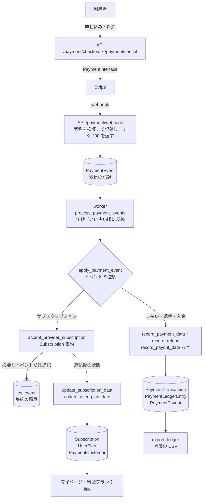

# MyUs - 総合メディアプラットフォーム SNS 設計書

## サービス概要

MyUsは「My Idea Know Us」を由来とする、YouTube型UIを採用した総合メディアプラットフォームSNSです。動画、音楽、漫画、画像、ブログ、チャットなど多様なメディアコンテンツの投稿・共有が可能で、リアルタイム通信機能も備えた統合型プラットフォームです。

## 主要機能

### コンテンツ投稿機能
- **Video**: 動画アップロード
- **Music**: 音楽アップロード
- **Blog**: リッチテキストエディタ対応ブログ
- **Comic**: 漫画投稿
- **Picture**: 画像投稿
- **Chat**: リアルタイムチャット

### ユーザー機能
- 認証システム
- プロフィール管理
- マイページ機能
- 通知設定
- 料金プラン管理

### インタラクション機能
- いいね機能
- コメント・リプライ
- フォロー/フォロワー機能
- 検索機能
- 通知システム

## システム設計図

### データモデル構造

```
【User System】
User
  ├─ Profile (個人情報)
  ├─ MyPage (公開情報)
  ├─ UserNotification
  ├─ UserPlan
  └─ Channel
        └─ is_default

【Channel System】
Channel
  ├─ owner
  ├─ avatar
  ├─ name
  ├─ description
  ├─ is_default
  └─ メディアコンテンツ
        ├─ videos
        ├─ musics
        ├─ comics
        ├─ pictures
        ├─ blogs
        └─ chats

【Media Contents】
※ 全メディアは Channel に紐づく

Video
  ├─ channel
  ├─ 動画ファイル、変換ファイル、サムネイル
  └─ カテゴリー、ハッシュタグ、いいね、閲覧数

Music
  ├─ 音楽ファイル、歌詞
  └─ ダウンロード可否設定

Blog

Comic
  ├─ ComicPage
  └─ ページ順序管理

Picture
Chat

【Interaction System】
Comment
  ├─ 階層構造
  └─ いいね機能付き

Message
  ├─ スレッド対応
  └─ TipTap エディタ対応

Follow
Notification
  └─ 確認済み/削除済み管理

【Master & Others】
Plan (料金プラン)
Category
HashTag
SearchTag (ユーザー検索タグ)
AccessLog
Advertise
```

## データモデル詳細

### ユーザーシステム

#### User
- 認証情報
- アバター画像
- アクティブ状態、スタッフ権限
- 関連モデルへの自動生成トリガー

#### Profile
- 個人情報
- 連絡先
- 住所情報
- 自己紹介文

#### MyPage
- 公開プロフィール情報
- バナー画像
- フォロワー/フォロー数カウント
- 広告表示設定
- Google Tag Manager ID

#### UserNotification
- メディアタイプ別通知設定
- アクション別通知設定

#### UserPlan
- 料金プラン情報（決済会社の顧客 ID・サブスクリプションは `PaymentCustomer`・`Subscription` に持つ）
- 支払い状態
- プラン開始/終了日

### チャンネルシステム

#### Channel
YouTubeのチャンネルと同様の概念。1人のユーザーが複数のチャンネルを所有でき、各チャンネルにメディアコンテンツを投稿する。

- **owner**: チャンネル所有者
- **ulid**: ユニーク識別子
- **avatar**: チャンネルアバター画像
- **name**: チャンネル名
- **description**: チャンネル説明
- **is_default**: デフォルトチャンネルフラグ
  - ユーザー作成時に1つのデフォルトチャンネルが自動生成される
  - メディア投稿時、明示的な指定がない場合はデフォルトチャンネルに投稿
- **created/updated**: 作成/更新日時

#### チャンネルの利用フロー
1. ユーザー登録時にデフォルトチャンネルが自動作成される
2. メディア投稿時、ユーザーのデフォルトチャンネル（`is_default=True`）を取得
3. メディアはチャンネルに紐づいて作成される
4. メディア一覧・詳細では `channel.owner` から作者情報を取得

### メディアコンテンツ

#### 共通機能（MediaModel）
- **channel**: 所属チャンネル
- **ulid**: ユニーク識別子
- タイトル、説明文
- カテゴリー、ハッシュタグ
- いいね機能
- 閲覧数カウント
- 公開/非公開設定
- 作成/更新日時

#### Video（動画）
- 動画ファイル、変換済みファイル
- サムネイル画像
- 検索対応

#### Music（音楽）
- 音楽ファイル
- 歌詞テキスト
- ダウンロード許可設定
- 検索対応

#### Comic（漫画）
- メイン画像
- ComicPageによる複数ページ管理
- ページ順序制御

#### Picture（画像）
- 画像ファイル
- シンプルな画像投稿機能

#### Blog（ブログ）
- リッチテキスト
- プレーンテキスト
- サムネイル画像

#### Chat（チャット）
- 有効期限設定
- リアルタイム通信対応
- スレッド数、参加者数カウント
- スコア計算機能

### インタラクションシステム

#### Comment
- 階層構造
- メディアタイプとIDによる汎用的な関連付け
- いいね機能
- リプライ数カウント

#### Message
- Chat内でのメッセージ
- スレッド対応
- TipTapエディタ対応

#### Follow
- フォロワー/フォロー関係管理
- 双方向の関係を記録

#### Notification
- 送信者/受信者
- 通知タイプとオブジェクトの汎用的な関連付け
- 確認済み/削除済み状態管理

### マスターデータ・その他

#### Plan
- 料金プラン定義
- Stripe API ID
- 価格、広告表示上限

#### Category / HashTag
- 日本語/英語名称管理
- メディアコンテンツとの多対多関連

#### SearchTag
- ユーザー毎の検索タグ管理
- 表示順序制御

#### AccessLog
- IPアドレス記録
- アクセス対象の記録

#### Advertise
- 広告コンテンツ管理
- 画像/動画対応
- 表示期間設定
- 全体/個別配信設定

### 決済システム

決済会社から届いたイベントを `PaymentEvent` に追記し、これを正とする（イベントソーシング）。ほかのテーブルはイベントから作る投影で、イベントを流し直せば作り直せる。確定申告・帳簿のために、期間ごとの売上・返金・決済手数料・消費税の集計と、銀行への入金の照合ができるようにする。

#### 全体像



- `PaymentEvent`（届いた事実）と `es_event`（集約の履歴）が正で、ほかのテーブルはそこから作る投影。`replay_payment_events` で作り直せる
- worker の反映は1件ずつ1つのトランザクションで行い、集約への追記と投影の保存も同じトランザクションに入る。失敗したら全部戻り、次の回にもう一度反映する

| 観点 | 仕組み |
|---|---|
| 決済会社 | `PaymentInterface` の裏に隠し、Stripe の実装は `api/src/adapter/external/payment/stripe/` に置く |
| 受信 | webhook は検証と記録だけにし、反映は worker が行う（Inbox） |
| 重複 | `PaymentEvent` の `(provider, event_id)` 一意制約。同じ webhook は1回だけ処理する |
| 届く順番 | サブスクリプションは集約が判断する（古い事実・同じ状態ではイベントを生まない）。取引・入金は `last_event_at` を比べる |
| 同時に届いたとき | `es_event` の `(aggregate_type, aggregate_id, seq)` 一意制約でぶつけ、コマンドを取り直す（楽観ロック） |
| 集約 | `state.py`・`event.py`・`decide.py`・`apply.py` に分けた、I/O を持たない関数 |
| 失敗 | worker が再試行し、30回で諦めて `log.error`。直したら `requeue_payment_events` で戻す |
| 帳簿 | 明細は追記だけ。売上・返金・決済手数料を符号付きの金額と消費税額で持つ |
| イベントの形 | 保存した JSON スキーマと比べ、過去のイベントを読めなくなる変更を検査する |

#### PaymentEvent
- 決済会社から届いたイベント（webhook）を1件ずつ追記する（本文・内容は更新・削除しない）。`provider` と `event_id` で一意。同じイベントが何度届いても1回だけ処理する
- webhook は検証して記録したら 200 を返すだけにし、投影への反映は worker（`process_payment_events`）が古い順に行う
- `processed_at`：反映した日時（未反映は `datetime.min`）。`attempts`・`last_error`：反映に失敗した回数と最後のエラー
- `payload`：受け取ったままの本文
- `content`：決済会社に依存しない形に整えた内容。受け取ったときに、本文に無い値（決済手数料など）も決済会社の API から取って入れる。投影はこの内容だけから作り、決済会社の API は呼ばない（流し直しても同じ結果になる）
- `external_id`：イベントの対象（サブスクリプション・取引・入金）の決済会社の ID。Stripe では、取引は PaymentIntent の ID（`pi_...`）

| Stripe のイベント | 種類 | 作るもの |
|---|---|---|
| `customer.subscription.created`・`updated`・`deleted` | `SubscriptionCreated` など | サブスクリプション・利用者のプラン |
| `invoice.paid` | `PaymentSucceeded` | 取引・売上（`Sale`）・決済手数料（`Fee`） |
| `invoice.payment_failed` | `PaymentFailed` | 取引の状態 |
| `charge.refunded` | `RefundIssued` | 返金（`Refund`）・取引の状態 |
| `payout.paid` | `PayoutPaid` | 入金・明細と入金の紐づけ |

売上を作るのは `invoice.paid` だけにする（`payment_intent.succeeded` からも作ると二重に数えてしまうため）。

0円の請求（無料期間・クーポン）や、支払い（PaymentIntent）の無い請求の失敗・返金は、お金が動いていないので記録しない（扱わないイベントとして 200 を返す）。

1つの請求に支払いが複数ある（失敗した支払いを取り消して、別の方法で払い直した等）ときは、`invoice.paid` では支払い済み（`paid`）の、`invoice.payment_failed` では支払い中（`open`）の支払いを取引とする。

#### PaymentCustomer
- ユーザーと、決済会社ごとの顧客 ID（Stripe の `cus_...` など）の対応。決済会社（`provider`）はここだけが持つ

#### Subscription
- 継続課金の状態（顧客・決済会社のサブスクリプション ID・商品・契約時の価格・状態・期間）

#### PaymentTransaction
- 1回の請求・支払い（取引）。顧客・サブスクリプション・通貨・税率・状態・支払日・請求書の番号（Stripe の請求書の番号）を持つ
- 金額は持たず、明細（`PaymentLedgerEntry`）の合計で表す

#### PaymentLedgerEntry
- 帳簿の明細。符号付きの金額と消費税額で1行ずつ追記する。金額・種類は更新・削除せず、あとから変えるのは入金（`payout`）の紐づけだけ
- 金額は入金の通貨（円）で持つ（Stripe の残高の取引の金額。外貨の決済でも、帳簿と入金の照合が合う）
- `external_id` は Stripe の残高の取引の ID（`txn_...`）。売上と決済手数料は同じ ID で、種類で分ける

| 種類 | 金額 | 消費税額 |
|---|---|---|
| `Sale`（売上） | ＋ | 税込の金額から `金額 × 10 / 110` を切り捨て |
| `Refund`（返金） | − | 同上（符号はマイナス） |
| `Fee`（決済手数料） | − | 0（カードの決済手数料は非課税） |

#### PaymentPayout
- 決済会社から銀行口座への入金（金額・入金日・状態）。通帳との照合に使う。どの明細がこの入金に含まれるかは、明細の `payout` で分かる

`PaymentTransaction`・`PaymentPayout` は、最後に反映したイベントの日時（`last_event_at`）を持ち、それより古いイベントが後から届いても反映しない。明細は届いた順に関係なく、まだ無いものだけ追記する。

サブスクリプションのイベントは、まず Subscription 集約（`api/src/domain/aggregate/subscription/`）に通す（`api/src/usecase/command/subscription.py` の `accept_provider_subscription`）。集約は決済会社の状態と今の状態を比べて、必要なイベントだけを `es_event` に追記し、追記後の状態を返す。`Subscription`・`UserPlan` は、この集約の状態から同じトランザクションで作る（届く順番の判断は集約だけが行い、`Subscription` は `last_event_at` を比べない。`last_event_at` には集約が最後に受け入れた日時を入れる）。画面は今まで通り `Subscription`・`UserPlan` を読む。集約の ID は決済会社のサブスクリプションの ID から `stripe:sub_xxx` の形で決めるので、ID を引くための表は持たない。同じサブスクリプションの最初のイベントが同時に届いても、`es_event` の `(aggregate_type, aggregate_id, seq)` の一意制約でぶつかり、コマンドの再試行で片方にまとまる。`replay_payment_events` で流し直すと、まだ集約の無いサブスクリプションは古い順に集約が作られ、既にある集約はイベントが増えずに同じ状態から `Subscription`・`UserPlan` を作り直す（既存データの移行もこれで行う）。

支払いのイベントが、対象のサブスクリプションより先に届いたときは、反映を失敗にして、worker が次の回にもう一度反映する（返金が取引より先に届いたときも同じ）。失敗が30回（10秒ごとで約5分）に達したら反映を諦めて `log.error` を出す。原因を直したら `requeue_payment_events` で戻す。

顧客・取引・明細・イベントは消せない（`on_delete=PROTECT`。帳簿は法律で一定期間残す必要があるため）。

#### 管理コマンド
- `uv run python manage.py process_payment_events`：未反映のイベントを古い順に反映する worker（10秒ごとに繰り返す。`--once` で1回だけ）。docker-compose の `myus_worker` で動かす。同時に2つ動かさない（行をロックしていないため）
- `uv run python manage.py requeue_payment_events`：反映を諦めたイベントの失敗回数を 0 に戻し、worker がもう一度反映するようにする
- `uv run python manage.py export_ledger --from 2026-01-01 --to 2026-12-31`：期間の明細を CSV で出す（日本時間。`--to` の日も含む）。列は日時・決済会社・種類・金額・消費税額・通貨・取引ID・請求書番号・入金ID・入金日
- `uv run python manage.py replay_payment_events --confirm`：取引・明細・入金・サブスクリプションを消し、反映済みの `PaymentEvent` を古い順に流し直して作り直す。`--confirm` が無いと何もしない。途中で失敗したら全部元に戻る。worker を止めてから実行する
- `uv run python manage.py export_event_schema`：`PaymentEvent` の `content` と集約のイベントの JSON スキーマを `api/tests/schema_compatibility/payment_event/`・`es_event/` に書き出す。過去のイベントを読めなくなる変更（項目の削除・型の変更・必須の項目の追加・enum の値の削除）は書き出さず、テストでも落ちる

#### クリエイターへの支払い（Connect を作るときに足す）
決済の時点でクリエイターに送金する形（Stripe の destination charge）では、MyUs が決済の主体になり、全額がいったん MyUs に入る。Connect を作るときに次を足す。
- `PaymentSeller`：クリエイターと、決済会社の受け取り口座（Stripe の `acct_...`）の対応。`Subscription.seller_id` はこれへの参照にする
- 明細の種類 `Transfer`（クリエイターへの送金。−）と `TransferReversal`（返金に伴う送金の取り消し。＋）。明細に `seller` を足す
- MyUs の取り分は `Sale + Refund + Transfer + TransferReversal`。総額のまま残すので、売上を総額・純額のどちらで計上しても集計できる

## 技術アーキテクチャ

### バックエンド
- **言語**: Python 3.15
- **フレームワーク**: Django 6.0
- **API**: django-ninja
- **ASGI サーバ**: Daphne
- **WebSocket**: Django Channels + channels-redis
- **データベース**: MySQL
- **認証**: JWT + カスタム認証バックエンド
- **依存管理**: uv
- **静的解析**: mypy + ruff

### バックエンドのレイヤー構成（`myus/api/src/`）
ドメイン駆動の 3 層構造で構成。

- **domain/**
  - `interface/`: dataclass による DTO と repository interface
  - `entity/`: Django ORM Model
- **usecase/**: ビジネスロジック層
- **adapter/**: HTTP エンドポイント
- **types/schema/**: API の入出力スキーマ
- **routers.py**: ルータの集約・登録
- **injectors/**: DI ヘルパ

### フロントエンド
- **フレームワーク**: Next.js 16
- **言語**: TypeScript 5.9
- **ライブラリ**: React 19
- **HTTP**: axios + neverthrow
- **エディタ**: TipTap
- **動画**: video.js + HLS
- **国際化**: next-i18next
- **依存管理**: pnpm
- **静的解析**: ESLint + Prettier
- **テスト**: Jest + Testing Library

### リアルタイム通信
- **WebSocket**: Django Channels + Redis
- **対象**: Chat メッセージ、スレッド機能

### 外部連携
- **決済**: Stripe API
- **メール**: SMTP
- **動画変換**: ffmpeg

### パフォーマンス最適化
- **インデックス**: 主要検索フィールドに設定
- **Select/Prefetch Related**: N+1 問題対策
- **bulk_get / bulk_save**: 一括取得・保存パターンを repository interface に統一

## セキュリティ設計

### 認証・認可
- メール認証必須
- パスワードハッシュ化
- セッション管理

### データ保護
- CSRF対策
- XSS対策
- SQLインジェクション対策

### プライバシー
- 個人情報の適切な分離
- 通知設定による情報公開制御
- フォロー関係による閲覧制限

## 拡張性

### プラグイン構造
- メディアタイプの追加が容易
- 共通基底クラス（MediaModel）の活用

### 国際化対応
- カテゴリー/ハッシュタグの多言語対応
- 日本語/英語の併記

### スケーラビリティ
- 非同期処理
- インデックス最適化
- キャッシュ機構（実装予定）

## 今後の展開

### 開発中機能
- 決済システムの完全統合

### 改善ポイント
- モバイルアプリ対応
- AI/機械学習による推薦システム
- コンテンツモデレーション機能
- 分析ダッシュボード

---

## 更新履歴

- **2026-04-30**: ドキュメントを実装に合わせて更新
  - 技術アーキテクチャを実態に合わせて記述
  - バックエンドのレイヤー構成を追記
  - 開発・実行環境セクションを新設
  - 実装済み項目を「開発中」から除外
- **2026-04 直近の主な変更**:
  - パスワード変更 / パスワードリセット / 退会機能を追加
  - 通知の `object_type` マッチを網羅的に検証するよう改善
  - `media bulk_get` / `chat bulk_get` の N+1 問題を解消
  - メディア取得・更新で `category_ulid` を扱えるよう拡張
  - docker-compose を現状リポジトリ構成に整合
  - **Quill エディタ依存を全廃**し TipTap に一本化
- **2026-01-21**: チャンネルシステムを追加
  - Channelモデルの追加
  - 全メディアが Channel 経由で管理されるよう変更
  - チャンネルの利用フローを文書化
