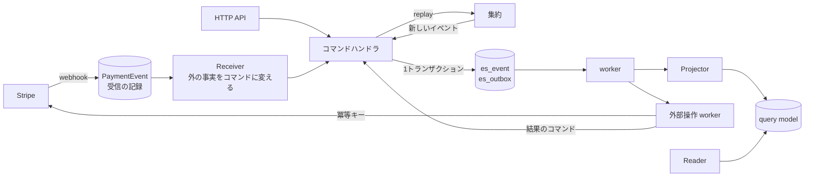

# ロードマップ（残り）

まだ終わっていないもの（保留・未定・確認待ちを含む）をここにまとめる。終わった項目は消す。

## 決済

決済の今の仕組み・方針・別の決済会社を足す手順は [myus.md](myus.md) の「決済システム」にある。

### 確認が残っているもの

- Stripe のダッシュボードで Connect を有効にし、webhook のエンドポイントに `checkout.session.completed` を足す。テスト環境で、口座の登録 → 記事を有料にする → 別のユーザーで買う → 有料部分が読める → ダッシュボードで「送金を取り消す」付きで返金 → 読めなくなり `TransferReversal` が付く、を確かめる
- テスト環境で、曲にハイレゾ（24bit の FLAC）を付けて販売する → 別のユーザーで買う → 詳細画面からダウンロードできる → 返金する → ダウンロードできなくなる、を確かめる。あわせて、1GB に近い FLAC を本番の構成で上げ、API の CloudFront の待ち時間（`origin_read_timeout` 60秒）で足りるかを確かめる。足りなければ、上限を上げる申請か、ブラウザから S3 に直接上げる形に変える
- Stripe のダッシュボードで4つの Price（`STRIPE_PRICE_ID_*`）に USD の金額（400・800・1200・2400。`domain/payment/plan.py` の `Plan.prices` と同じ）を足し、テスト環境で国/地域が日本以外のユーザーがドルで checkout・プラン変更できるかを確かめる
- Stripe のダッシュボードで Billing Portal の設定を保存し（保存するまでは portal を開けない）、支払い方法の変更から決済の画面に戻ってくるかを確かめる
- 本物の Stripe（テスト環境）で `invoice.paid`・`charge.refunded`・`payout.paid` を通し、取引・明細・入金が正しく作られるかを確かめる
- Stripe CLI で `customer.subscription.*` を送り、`es_event` と `Subscription`・`UserPlan` が正しく作られるかを確かめる

---

## Event Sourcing + CQRS

### 目的

- 決済を、集約・コマンド・イベントを持つ Event Sourcing + CQRS に移す
- 自サービスの操作（申し込み・解約・送金）も事実として残し、外部 API の二重実行を防げるようにする
- イベントの保存形式を版で管理し、何年たっても過去のイベントを読めるようにする

### 今の状態

Phase 1〜5 と Phase 6 の一部は完了した（ES の基盤・保存形式の検査・webhook の受け口と worker・Subscription 集約・解約の要求と結果の記録・Subscription の進捗つきの Projector と `reproject`）。今の仕組みは [myus.md](myus.md) の「決済システム」、コードの決まりは [backend.md](backend.md) にある。

checkout を要求と結果に分けることと、Phase 6 の残り・Phase 7 以降は **保留**。進めるときは、その時点の規模と問題を見て Phase ごとに決める。解約で結果が分からないまま残った要求を自動で呼び直す worker は、必要になったら足す（今は次の解約で同じ冪等キーを使って呼び直す）。

### 進め方の原則

- 集約は1つずつ移す。移している間も、今の決済は動かし続ける
- 各 PR は独立してマージできる単位に切る。旧テーブルの削除は、読み手を全部移した後にまとめて行う
- 業務判断と状態遷移は純粋な関数にする。時刻・採番・外部 API の応答は呼び出し側が渡し、保存・配信・外部操作も呼び出し側が担う
- 集約の ID は、自然に一意に決まるもの（決済会社の ID など）があればそれから作る（例：`stripe:sub_xxx`）。ID を引くためだけの表は作らない
- 集約やイベントストアのテストは、ドメインと実装が固まるまで書かない
- worker は DB を定期的に読む形で始める。件数が増えたら Redis Streams か SQS を検討する

---

### 全体設計の最終形（参考）

| テーブル | 役割 | 状態 |
|---|---|---|
| `es_event` | 集約ごとのイベント履歴（追記のみ）。`(aggregate_type, aggregate_id, seq)` 一意 | あり |
| `es_outbox` | 確定したイベントの配信記録 | あり（読む worker は、非同期の Projector が要るときに作る） |
| `es_projection_progress` | Projector・集約ごとの反映済みの seq | あり |
| `es_snapshot` | 集約の状態のキャッシュ | イベントが多い集約（Ledger）で `replay` が遅くなってから足す |
| `es_<集約>_<事実>_index` | 事実索引（一意性・過去の事実への参照）。追記のみ | Phase 7（Ledger）で足す |

| 置き場 | 内容 | 状態 |
|---|---|---|
| `myus/domain/<ドメイン>/<集約>/` | `state.py`・`event.py`・`decide.py`・`apply.py`。I/O を持たない | あり |
| `myus/usecase/es/_convert.py` | `handle_command`（集約に書き込む共通の手順） | あり |
| `myus/usecase/<ドメイン>/_convert.py` | 集約ごとのコマンド（`payment` の `save_subscription_event_data` など） | あり |
| `myus/usecase/receiver/` | Receiver（外の事実やほかの集約のイベントを受けてコマンドを打つ） | Phase 6 以降 |
| `myus/usecase/<ドメイン>/_convert.py` の `project_<集約>_data` | Projector（集約の状態から query model と進捗を書く） | あり。Subscription は顧客の保存などを使うので、import が循環しないよう `usecase/payment/_convert.py` に置いた |
| `myus/usecase/query/` | query usecase と Reader | Phase 6 の残り |

---

### ⏸ checkout を要求と結果に分ける

- Stripe のサブスクリプションは支払いが終わってから作られるので、checkout の時点ではサブスクリプションの ID（集約の ID）が無く、今の Subscription 集約には載せられない。載せるには checkout 用の別の集約が要るが、checkout の画面は二重に作っても支払われるのは1つだけで、得るものが小さい。有料プランの契約中に新しく checkout できないことは、`create_checkout` で今の `Subscription` を見て止めている
- 進めるときは、解約と同じく要求の EventId を冪等キーにする（解約の形は myus.md の「決済システム」）

### ⏸ Phase 6 の残り: 非同期の Projector と世代

済んだこと：Subscription の Projector は、追記と同じトランザクションで投影と `last_applied_seq` を保存し、反映済みより進んでいないときは保存しない。`reproject --projector Subscription --confirm` で `es_event` から作り直せる（worker を止め、消してから1つのトランザクションで作る）。

- 投影を追記と別に作りたくなったら、`es_outbox` を読む worker を作る。通知は「どの集約に新しいイベントがあるか」だけに使い、イベントはイベントストアから取り直す
- 動かしたまま作り直したくなったら、query model と進捗に世代（`generation`）を持たせ、新しい世代を並行して作ってから切り替える
- 取引・帳簿を集約にしたら（Phase 7）、`replay_payment_events` を `reproject` に置き換える

### ⏸ Phase 7: 取引・入金・帳簿

- `PaymentTransaction`（`Paid`・`Failed`・`Refunded`）と `PaymentPayout`（`Paid`）を集約にし、今のテーブルは query model にする
- `Ledger` 集約は決済会社 × 会計年度（`Ledger(provider, fiscal_year)`）。年度を閉じたら新しい記帳を拒否する
- 事実索引 `es_ledger_entry_index`：`(ledger_id, idempotency_key)` 一意。同じ明細を2回記帳しようとすると、2回目は重複のエラーになる
- 帳簿の明細の query model を Projector で作り、`export_ledger` をそこから読む
- ブログの有料部分で投影として作った売り手・購入・送金（`Transfer`・`TransferReversal`）の明細も、このときに Ledger 集約のイベントに移す

### ⏸ Phase 8: 旧構成の撤去

- `apply_payment_event`・`last_event_at` の比較・`replay_payment_events` を消す
- query model にしなかった旧テーブル・カラムを消す
- 終わったら、決済まわりの usecase が Django ORM・Stripe SDK を直接使わず、`es_event` から全 query model を作り直せる

---

### やらないこと

- **メディア・コメント・フォロー・通知などの CRUD は ES にしない**。履歴に業務上の意味がなく、普通のテーブルで足りる
- **最初からメッセージ基盤（SQS・Kafka）を入れない**。DB の outbox と worker で始め、件数や遅延が問題になってから替える
- **全集約に snapshot を付けない**。イベントが多い集約（Ledger）で、全件の `replay` が遅くなってから付ける

### リスクと対策

| リスク | 対策 |
|---|---|
| 非同期の投影で、書いた直後に画面へ反映されない | 集約1件の表示は Repository から読む。一覧・集計だけを query model から読む |
| worker が止まって投影や外部操作が進まない | 未処理の件数と最も古い行の時刻をログに出し、閾値を超えたら通知する |
| 1人で進めるには部品が多い | Phase ごとに止めても動く形にしてある |
| イベントの形を変えて、過去のイベントが読めなくなる | 保存したスキーマとの比較（`test_schema_compatibility.py`）で止める |

## バックエンドの構成

### 決めていないこと

- `es` を `event_store` にするか（`domain/es`・`adapter/outbound/db/es`・`usecase/es`・`utils/functions/es.py`。`es_event` テーブルの名前は変えない）
- `usecase/<ドメイン>/core.py` の名前

### やらないこと

- `db/models/` の `users.py`・`common.py`・`master.py` をモデルごとのファイルに分ける

## ⏸ 投稿者ごとの Google Tag Manager

マイページの `tag_manager_id` は登録できるが、読み込みはしていない。GTM は任意のスクリプトを動かせるので、投稿者の GTM を MyUs のページで読み込むと、投稿者が閲覧者のページで好きなスクリプトを動かせてしまう（Cookie 以外の情報の抜き取り・画面の書き換えなど）。入れるなら、MyUs のドメインとは別の場所で動かす仕組みが要る

## メディアの一覧の速さ

今は困っていない。一覧が遅いと感じたら、`EXPLAIN` でどこが重いかを確かめてから、次を入れる。一覧を取る処理は `adapter/outbound/db/media/common.py`（`filter_queryset`・`sort_queryset`・`get_ids_queryset`）にまとまっている。

### 遅くなったら検討すること

- **like 数を列に持つ**：score で並べるたびに、絞り込みに当たる全行の `Count("like")` を数えている。メディアのテーブルに `like_count` を持たせ、いいねのたびに増減すれば集計が要らなくなる。代わりに、いいねの処理で列の更新が要る

## インフラ

構成案は [infrastructure.md](infrastructure.md) にある。Terraform の書き方は rcmr-studio の `infra/aws` に合わせ、個人開発に要らないものは入れない。

### 方針（決めたこと）

- 環境は `prod` の 1 つで始める。`stg` は必要になってから足す
- スタック（state）は `infra/aws/prod/{general,common,products/myus}/<名前>/` に分ける
- 通知は今はメールで送る。運用の通知は、あとで Slack にまとめる。予算・費用の異常・監視のアラームを SNS に送り、Amazon Q Developer in chat applications（旧 AWS Chatbot）で Slack に流す
- NAT を使わない。EC2 はパブリックサブネット、RDS は VPC の外に出られない datastore サブネットに置く

### 先に手作業でやること

- GitHub のリポジトリの Variables に `AWS_ACCOUNT_ID`、Secrets に `TF_VAR_EMAILS_FOR_COST`・`TF_VAR_EMAILS_FOR_ALARM`（どちらも `["xxx@example.com"]` の形）を入れる。`AWS_ACCOUNT_ID` が空のあいだ、CI は `fmt`・`validate` だけを流す
- `AWS_ACCOUNT_ID` を入れたら、Actions の `infra` を main で手動実行して、残りのスタックを `stacks.txt` の順に apply する
- `prod/products/myus/monitoring` を apply したら、SNS から届く確認のメールのリンクを開く（東京と us-east-1 の 2 通）。開くまでアラームは届かない
- `prod/common/parameters` を apply したら、各パラメータの本当の値を CLI で入れる。`FIXME` のままのパラメータがあると、デプロイは止まる（`aws ssm put-parameter --profile myus-prod --type SecureString --overwrite --name /myus/prod/SECRET_KEY --value '...'`）

### AWS アカウントの今の形

2026-11-19 に次のところまで済ませた。

- AWS の組織は 3 つのアカウントでできている。サービスを置くのは `MyUs`。`MyUs Management Account` は組織と請求、`MyUs Identity Delegated Admin` は Identity Center を持つ
- Identity Center はアカウントへの割り当てを管理できない形で作られたので、手元からは `MyUs` の IAM ユーザー `terraform` のアクセスキーで入る。プロファイルは `myus-prod`。キーは `~/.aws/credentials` にあり、作り直すときはキーの説明 `Mac terraform myus-prod` を目印にする
- 管理用のアカウントにある組織の SCP は、アカウントを作ったときに使えるリージョンを `ap-southeast-2`・`us-east-1`・`us-west-2` に絞っていた。`RegionFloor` に `ap-northeast-1` を、`UsEast1Partitional` に `cloudwatch:*`・`sns:*` を手で足した。東京で急に権限のエラーが出たら、AWS に戻されていないかをまずここで見る
- state 用の S3 バケット `terraform-myus-prod` を作り、バージョニングと公開の遮断を有効にした
- `prod/general/iam-role` と `prod/general/cost` を手元から apply した。予算の通知先は運営用の Gmail
- 管理用のアカウントのルートユーザーと、普段「AWS sign-ins」から入るときの AWS Builder ID に MFA を付けた。Builder ID のメールは運営用の Gmail に `+builderid` を付けたもので、回復用のメールは個人のもの

### ドメインとメールの手作業

`acm`・`dns`・`mail` のスタックを apply したあとに行う。

- Vercel のプロジェクトに `myus.media` と `www.myus.media` を足す。レコードは `dns` のスタックが作っている
- Parameter Store の `ALLOWED_HOSTS`・`CORS_ALLOWED_ORIGINS`・`CSRF_TRUSTED_ORIGINS`・`FRONTEND_URL` を、`api.myus.media`・`https://myus.media` に合わせて入れる。`EMAIL_FROM` は `noreply@myus.media` のように `myus.media` のアドレスにする
- Vercel の環境変数の API の URL を `https://api.myus.media` にする
- SES の管理画面で、`myus.media` の DKIM と MAIL FROM が「確認済み」になったかを確かめる
- DMARC は `p=none` で始めている。問い合わせを受けるアドレスを決めたら、報告の宛先（`rua`）を足し、届いた報告を見て `p=quarantine` に上げる

有料のメディアを CloudFront の署名付き Cookie で守るのは、有料のメディアを出すときに `prod/products/myus/media` に足す。

### やらないこと

- Organizations・SCP・Identity Center のコード化
- GuardDuty・Config・Macie・Inspector など監査系のサービス（月額がかかる）
- Datadog・Sentry・Tailscale などの外部サービスの Terraform

---

## 本番を始める前の整備（コード以外）

コードの外で、本番を始めるまでに済ませることをまとめる。上から順に進める。インフラの手作業は「インフラ」の章にある。

### ドメイン

`myus.media` を 2026-11-19 に Route 53 Domains で取った。年 50 USD で、自動更新・移管ロック・WHOIS の代理公開を有効にし、連絡先のメールの確認も済んでいる。

- 使う前に「MyUs」の商標の登録状況を J-PlatPat と米国の USPTO で確かめる。`myus.com` を MyUS.com という海外の転送サービスが使っている

### 事業者としての手続き

- 税務署に開業届を出す。青色申告にするなら青色申告承認申請書も一緒に出す
- 適格請求書発行事業者（インボイス）に登録するかを決める。売り上げが 1,000 万円を超えるまでは任意
- 売り上げ・手数料・送金の記録の付け方と、会計ソフトを決める
- 事業用の銀行口座を作る。Stripe の入金先にする

### 法律まわりの文書

- 利用規約：投稿者と買う人の権利、有料の記事・楽曲の扱い、返金、禁止事項、アカウントの停止
- プライバシーポリシー：集める情報、Stripe・AWS・Vercel など外に渡す先、Cookie、海外のユーザー
- 特定商取引法に基づく表記：有料プランと有料コンテンツを売るので必須。Stripe の本番の審査でも見られる。住所と電話番号は請求があれば開示する書き方にできる
- 権利を侵害する投稿の通報の窓口と、削除までの手順を決める
- 投稿者に売り上げを渡す条件：手数料・送金の時期・返金のときの扱い

### 音楽の権利

- 利用者が楽曲を上げて配信・販売するので、JASRAC・NexTone と UGC サービスとしての許諾契約が要るかを確かめる
- オリジナルの曲だけに限るなら、利用規約にそう書き、カバー曲などの扱いを決める

### Stripe の本番

- 本番のアカウントの審査を出す。サイトに特定商取引法に基づく表記・利用規約・プライバシーポリシーが出ている必要がある
- 明細に出る名前（statement descriptor）と、問い合わせ先を設定する
- Connect の本番の申請をする。プラットフォームとしての情報と、投稿者への説明を求められる
- テスト環境での確認は「決済」の章を済ませておく

### メールと問い合わせ

- `support@myus.media` など、問い合わせを受けるアドレスを用意する。SES は送るだけなので、受ける先を別に決める
- SES の本番利用の申請を出す。送るメールの種類と、バウンス・苦情の扱いを書く
- 問い合わせの窓口をサイトのどこに出すかを決める

### アカウントと鍵の管理

- AWS・Stripe・Vercel・GitHub・ドメインの取得先のアカウントに MFA を付ける
- パスワードと復旧コードをパスワードマネージャーにまとめる
- 運営用のメールアドレスを個人のものと分ける

### 公開の前に

- Google Search Console にドメインを登録し、サイトマップを送る
- OGP の画像・favicon・サイト名を整える
- 公式の SNS アカウントの名前を押さえる
- 障害のときの告知先を決める
