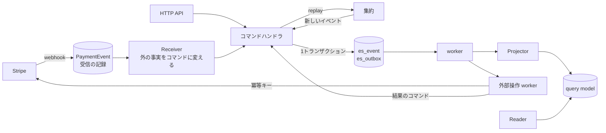

# ロードマップ（残り）

まだ終わっていないもの（保留・未定・確認待ちを含む）をここにまとめる。終わった項目は消す。

## 決済

決済の今の仕組み（Stripe・webhook・帳簿・Subscription 集約）は [myus.md](myus.md) の「決済システム」にある。ここには、まだ作っていないものだけを残す。

### 方針（決めたこと）

- **`None` を使わない**：`| None` の代わりに、判別共用体・初期値（`""`・`0`・`datetime.min`）・`Failed` の型で表す
- **金額は `Money` で包む**：`amount: int` を単独で関数の引数にしない
- **`provider` は `PaymentEvent`・`PaymentCustomer`・`PaymentPayout` だけが持つ**：サブスクリプション・取引は顧客からたどる
- **決済会社の ID（`external_id`）は文字列として持つだけ**：ドメインの側で中身を解釈しない
- **売り手は User**：別の `Merchant` テーブルは作らない。受け取り口座は `PaymentSeller`（User と口座 ID の対応）に持つ。MyUs のプランの課金は `seller_id=""` で表す

### ⏸ クリエイターが売る機能（Stripe Connect・Store・Product）

当面は作らない（2026-10-26 決定）。作るときは 下の「Event Sourcing + CQRS」の Phase 7（帳簿の集約）の後にし、`PaymentSeller`・`Store`・`Product` は最初から集約として作る。

| 順 | 内容 |
|---|---|
| 1 | `PaymentSeller` を足し、`Subscription.seller_id` をその参照にする。明細の種類に `Transfer`（クリエイターへの送金。−）・`TransferReversal`（返金に伴う送金の取り消し。＋）を足す（詳しくは myus.md の「クリエイターへの支払い」） |
| 2 | Stripe Connect の登録：`PaymentInterface.onboard_seller` と `POST /payment/onboard`、FE の登録ボタン |
| 3 | `Store`・`Product`・`Price` のテーブル |
| 4 | 商品を Stripe に同期し（`sync_product`）、`CheckoutData.marketplace.seller_id` に受け取り口座を入れて決済する |

### 🔶 多通貨

言語は対応済み（決済画面を表示中の言語で出し、支払い後もその言語のページに戻す）。多通貨（`Currency` を価格・決済に使う）は、着手するか未定。

### 確認が残っているもの

- Stripe のダッシュボードで Billing Portal の設定を保存し（保存するまでは portal を開けない）、支払い方法の変更から決済の画面に戻ってくるかを確かめる
- 本物の Stripe（テスト環境）で `invoice.paid`・`charge.refunded`・`payout.paid` を通し、取引・明細・入金が正しく作られるかを確かめる
- Stripe CLI で `customer.subscription.*` を送り、`es_event` と `Subscription`・`UserPlan` が正しく作られるかを確かめる

### 別の決済会社を足すときの手順

1. `myus/utils/enum/payment.py` の `PaymentProvider` に値を足す（DB の `provider` の選択肢も変わるので、マイグレーションを作る）
2. `myus/adapter/outbound/payment/<provider>/` に `PaymentInterface` の実装（`provider.py`・`_convert.py`）を置く
3. `injectors/index.py` の `provide_payment_providers` の辞書に1行足す
4. `adapter/inbound/payment.py` に、その決済会社の webhook の入口（例：`/payment/webhook/gmo`）を足し、署名を取り出して `verify_webhook(PaymentProvider.XXX, payload, signature)` を呼ぶ
5. キーなどを `config/env.py` と `envs/sample.env` に足す
6. 新しく始める決済をその会社にするなら、`usecase/payment/core.py` の `CHECKOUT_PROVIDER` を変える（ユーザーや契約ごとに選ぶなら、そこを選ぶ処理に置き換える）

どの決済会社を使うかは、決済の画面の作成は `CHECKOUT_PROVIDER`、解約は顧客（`PaymentCustomer`）の `provider`、webhook は受けたイベントの `provider` で決まる。

---

## Event Sourcing + CQRS

### 目的

- 決済を、集約・コマンド・イベントを持つ Event Sourcing + CQRS に移す
- 自サービスの操作（申し込み・解約・送金）も事実として残し、外部 API の二重実行を防げるようにする
- イベントの保存形式を版で管理し、何年たっても過去のイベントを読めるようにする

### 今の状態

Phase 1〜4 は完了した（ES の基盤・保存形式の検査・webhook の受け口と worker・Subscription 集約）。今の仕組みは [myus.md](myus.md) の「決済システム」、コードの決まりは [backend.md](backend.md) にある。

Phase 5 は解約から進めている（外部操作の worker は作らず、リクエストの中で要求と結果を記録する形）。checkout と Phase 6 以降は **保留**。進めるときは、その時点の規模と問題を見て Phase ごとに決める。

### 進め方の原則

- 集約は1つずつ移す。移している間も、今の決済は動かし続ける
- 各 PR は独立してマージできる単位に切る。旧テーブルの削除は、読み手を全部移した後にまとめて行う
- 業務判断と状態遷移は純粋な関数にする。時刻・採番・外部 API の応答は呼び出し側が渡し、保存・配信・外部操作も呼び出し側が担う
- 集約の ID は、自然に一意に決まるもの（決済会社の ID など）があればそれから作る（例：`stripe:sub_xxx`）。ID を引くためだけの表は作らない
- 集約やイベントストアのテストは、ドメインと実装が固まるまで書かない
- worker は DB を定期的に読む形で始める。件数が増えたら Redis Streams か SQS を検討する

---

### 全体設計の最終形（参考）

| テーブル | 役割 | 状態 |
|---|---|---|
| `es_event` | 集約ごとのイベント履歴（追記のみ）。`(aggregate_type, aggregate_id, seq)` 一意 | あり |
| `es_outbox` | 確定したイベントの配信記録 | あり（配信は Phase 6） |
| `es_projection_progress` | Projector ごとの進捗 | Phase 6 で足す |
| `es_snapshot` | 集約の状態のキャッシュ | イベントが多い集約（Ledger）で `replay` が遅くなってから足す |
| `es_<集約>_<事実>_index` | 事実索引（一意性・過去の事実への参照）。追記のみ | Phase 7（Ledger）で足す |

| 置き場 | 内容 | 状態 |
|---|---|---|
| `myus/domain/aggregate/<集約>/` | `state.py`・`event.py`・`decide.py`・`apply.py`。I/O を持たない | あり |
| `myus/usecase/es/_convert.py` | `handle_command`（集約に書き込む共通の手順） | あり |
| `myus/usecase/<ドメイン>/_convert.py` | 集約ごとのコマンド（`payment` の `save_subscription_event_data` など） | あり |
| `myus/usecase/receiver/` | Receiver（外の事実やほかの集約のイベントを受けてコマンドを打つ） | Phase 5 以降 |
| `myus/usecase/projector/`・`query/` | Projector と専用の Writer、query usecase と Reader | Phase 6 |

---

### 🔶 Phase 5: 外部操作を要求と結果に分ける

- ✅ **解約：** 要求（`Subscription.CancellationRequested.V1`）を記録し、その EventId を冪等キーにして Stripe を呼ぶ。成功したら Stripe から今の状態を取り直して受理し（`CancellationScheduled`）、断られたら `CancellationFailed` を記録する。結果が分からないとき（通信の失敗）は要求を残し、次の解約で同じキーを使って呼び直す。外部操作の worker は作らず、リクエストの中で行う（未決着の要求を自動で呼び直すのは、必要になったら worker で足す）
- ⏸ **checkout：** 保留。Stripe のサブスクリプションは支払いが終わってから作られるので、checkout の時点ではサブスクリプションの ID（集約の ID）が無く、今の Subscription 集約には載せられない。載せるには checkout 用の別の集約が要るが、checkout の画面は二重に作っても支払われるのは1つだけで、得るものが小さい。有料プランの契約中に新しく checkout できないことは、`create_checkout` で今の `Subscription` を見て止めている
- **冪等キー：** 解約は要求の EventId をキーにした。checkout も同じ形にする

### ⏸ Phase 6: Projector と query model

- `es_outbox` の通知は「どの集約に新しいイベントがあるか」だけに使い、イベントはイベントストアから取り直す
- 投影の結果と `last_applied_seq` を同じトランザクションで保存する。保存済みより進んでいないときは保存しない
- 再投影は query model と進捗に世代（`generation`）を持たせ、新しい世代を並行して作ってから切り替える。`replay_payment_events` を `reproject --projector <name>` に置き換える

### ⏸ Phase 7: 取引・入金・帳簿

- `PaymentTransaction`（`Paid`・`Failed`・`Refunded`）と `PaymentPayout`（`Paid`）を集約にし、今のテーブルは query model にする
- `Ledger` 集約は決済会社 × 会計年度（`Ledger(provider, fiscal_year)`）。年度を閉じたら新しい記帳を拒否する
- 事実索引 `es_ledger_entry_index`：`(ledger_id, idempotency_key)` 一意。同じ明細を2回記帳しようとすると、2回目は重複のエラーになる
- 帳簿の明細の query model を Projector で作り、`export_ledger` をそこから読む
- クリエイターへの支払い（上の「決済」の「クリエイターが売る機能」）はこの後に進める。`PaymentSeller`・`Store`・`Product` は最初から集約として作り、送金（`Transfer`・`TransferReversal`）は Ledger 集約のイベントとして足す

### ⏸ Phase 8: 旧構成の撤去

- `apply_payment_event`・`last_event_at` の比較・`replay_payment_events` を消す
- query model にしなかった旧テーブル・カラムを消す
- 終わったら、決済まわりの usecase が Django ORM・Stripe SDK を直接使わず、`es_event` から全 query model を作り直せる

---

### やらないこと

- **メディア・コメント・フォロー・通知などの CRUD は ES にしない**。履歴に業務上の意味がなく、普通のテーブルで足りる
- **最初からメッセージ基盤（SQS・Kafka）を入れない**。DB の outbox と worker で始め、件数や遅延が問題になってから替える
- **全集約に snapshot を付けない**。イベントが多い集約（Ledger）で、全件の `replay` が遅くなってから付ける

### リスクと対策

| リスク | 対策 |
|---|---|
| 非同期の投影で、書いた直後に画面へ反映されない | 集約1件の表示は Repository から読む。一覧・集計だけを query model から読む |
| worker が止まって投影や外部操作が進まない | 未処理の件数と最も古い行の時刻をログに出し、閾値を超えたら通知する |
| 1人で進めるには部品が多い | Phase ごとに止めても動く形にしてある |
| イベントの形を変えて、過去のイベントが読めなくなる | 保存したスキーマとの比較（`test_schema_compatibility.py`）で止める |
