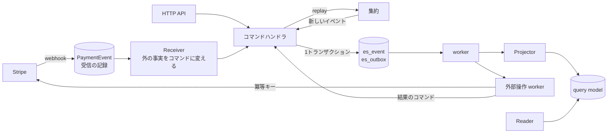

# ロードマップ（残り）

まだ終わっていないもの（保留・未定・確認待ちを含む）をここにまとめる。終わった項目は消す。

## 決済

決済の今の仕組み・方針・別の決済会社を足す手順は [myus.md](myus.md) の「決済システム」にある。

### 確認が残っているもの

- Stripe のダッシュボードで Connect を有効にし、webhook のエンドポイントに `checkout.session.completed` を足す。テスト環境で、口座の登録 → 記事を有料にする → 別のユーザーで買う → 有料部分が読める → ダッシュボードで「送金を取り消す」付きで返金 → 読めなくなり `TransferReversal` が付く、を確かめる
- テスト環境で、曲にハイレゾ（24bit の FLAC）を付けて販売する → 別のユーザーで買う → 詳細画面からダウンロードできる → 返金する → ダウンロードできなくなる、を確かめる。あわせて、1GB に近い FLAC を本番の構成で上げ、API の CloudFront の待ち時間（`origin_read_timeout` 60秒）で足りるかを確かめる。足りなければ、上限を上げる申請か、ブラウザから S3 に直接上げる形に変える
- Stripe のダッシュボードで4つの Price（`STRIPE_PRICE_ID_*`）に USD の金額（400・800・1200・2400。`domain/payment/plan.py` の `Plan.prices` と同じ）を足し、テスト環境で国/地域が日本以外のユーザーがドルで checkout・プラン変更できるかを確かめる
- Stripe のダッシュボードで Billing Portal の設定を保存し（保存するまでは portal を開けない）、支払い方法の変更から決済の画面に戻ってくるかを確かめる
- 本物の Stripe（テスト環境）で `invoice.paid`・`charge.refunded`・`payout.paid` を通し、取引・明細・入金が正しく作られるかを確かめる
- Stripe CLI で `customer.subscription.*` を送り、`es_event` と `Subscription`・`UserPlan` が正しく作られるかを確かめる

---

## Event Sourcing + CQRS

### 目的

- 決済を、集約・コマンド・イベントを持つ Event Sourcing + CQRS に移す
- 自サービスの操作（申し込み・解約・送金）も事実として残し、外部 API の二重実行を防げるようにする
- イベントの保存形式を版で管理し、何年たっても過去のイベントを読めるようにする

### 今の状態

Phase 1〜5 と Phase 6 の一部は完了した（ES の基盤・保存形式の検査・webhook の受け口と worker・Subscription 集約・解約の要求と結果の記録・Subscription の進捗つきの Projector と `reproject`）。今の仕組みは [myus.md](myus.md) の「決済システム」、コードの決まりは [backend.md](backend.md) にある。

checkout を要求と結果に分けることと、Phase 6 の残り・Phase 7 以降は **保留**。進めるときは、その時点の規模と問題を見て Phase ごとに決める。解約で結果が分からないまま残った要求を自動で呼び直す worker は、必要になったら足す（今は次の解約で同じ冪等キーを使って呼び直す）。

### 進め方の原則

- 集約は1つずつ移す。移している間も、今の決済は動かし続ける
- 各 PR は独立してマージできる単位に切る。旧テーブルの削除は、読み手を全部移した後にまとめて行う
- 業務判断と状態遷移は純粋な関数にする。時刻・採番・外部 API の応答は呼び出し側が渡し、保存・配信・外部操作も呼び出し側が担う
- 集約の ID は、自然に一意に決まるもの（決済会社の ID など）があればそれから作る（例：`stripe:sub_xxx`）。ID を引くためだけの表は作らない
- 集約やイベントストアのテストは、ドメインと実装が固まるまで書かない
- worker は DB を定期的に読む形で始める。件数が増えたら Redis Streams か SQS を検討する

---

### 全体設計の最終形（参考）

| テーブル | 役割 | 状態 |
|---|---|---|
| `es_event` | 集約ごとのイベント履歴（追記のみ）。`(aggregate_type, aggregate_id, seq)` 一意 | あり |
| `es_outbox` | 確定したイベントの配信記録 | あり（読む worker は、非同期の Projector が要るときに作る） |
| `es_projection_progress` | Projector・集約ごとの反映済みの seq | あり |
| `es_snapshot` | 集約の状態のキャッシュ | イベントが多い集約（Ledger）で `replay` が遅くなってから足す |
| `es_<集約>_<事実>_index` | 事実索引（一意性・過去の事実への参照）。追記のみ | Phase 7（Ledger）で足す |

| 置き場 | 内容 | 状態 |
|---|---|---|
| `myus/domain/<ドメイン>/<集約>/` | `state.py`・`event.py`・`decide.py`・`apply.py`。I/O を持たない | あり |
| `myus/usecase/es/_convert.py` | `handle_command`（集約に書き込む共通の手順） | あり |
| `myus/usecase/<ドメイン>/_convert.py` | 集約ごとのコマンド（`payment` の `save_subscription_event_data` など） | あり |
| `myus/usecase/receiver/` | Receiver（外の事実やほかの集約のイベントを受けてコマンドを打つ） | Phase 6 以降 |
| `myus/usecase/<ドメイン>/_convert.py` の `project_<集約>_data` | Projector（集約の状態から query model と進捗を書く） | あり。Subscription は顧客の保存などを使うので、import が循環しないよう `usecase/payment/_convert.py` に置いた |
| `myus/usecase/query/` | query usecase と Reader | Phase 6 の残り |

---

### ⏸ checkout を要求と結果に分ける

- Stripe のサブスクリプションは支払いが終わってから作られるので、checkout の時点ではサブスクリプションの ID（集約の ID）が無く、今の Subscription 集約には載せられない。載せるには checkout 用の別の集約が要るが、checkout の画面は二重に作っても支払われるのは1つだけで、得るものが小さい。有料プランの契約中に新しく checkout できないことは、`create_checkout` で今の `Subscription` を見て止めている
- 進めるときは、解約と同じく要求の EventId を冪等キーにする（解約の形は myus.md の「決済システム」）

### ⏸ Phase 6 の残り: 非同期の Projector と世代

済んだこと：Subscription の Projector は、追記と同じトランザクションで投影と `last_applied_seq` を保存し、反映済みより進んでいないときは保存しない。`reproject --projector Subscription --confirm` で `es_event` から作り直せる（worker を止め、消してから1つのトランザクションで作る）。

- 投影を追記と別に作りたくなったら、`es_outbox` を読む worker を作る。通知は「どの集約に新しいイベントがあるか」だけに使い、イベントはイベントストアから取り直す
- 動かしたまま作り直したくなったら、query model と進捗に世代（`generation`）を持たせ、新しい世代を並行して作ってから切り替える
- 取引・帳簿を集約にしたら（Phase 7）、`replay_payment_events` を `reproject` に置き換える

### ⏸ Phase 7: 取引・入金・帳簿

- `PaymentTransaction`（`Paid`・`Failed`・`Refunded`）と `PaymentPayout`（`Paid`）を集約にし、今のテーブルは query model にする
- `Ledger` 集約は決済会社 × 会計年度（`Ledger(provider, fiscal_year)`）。年度を閉じたら新しい記帳を拒否する
- 事実索引 `es_ledger_entry_index`：`(ledger_id, idempotency_key)` 一意。同じ明細を2回記帳しようとすると、2回目は重複のエラーになる
- 帳簿の明細の query model を Projector で作り、`export_ledger` をそこから読む
- ブログの有料部分で投影として作った売り手・購入・送金（`Transfer`・`TransferReversal`）の明細も、このときに Ledger 集約のイベントに移す

### ⏸ Phase 8: 旧構成の撤去

- `apply_payment_event`・`last_event_at` の比較・`replay_payment_events` を消す
- query model にしなかった旧テーブル・カラムを消す
- 終わったら、決済まわりの usecase が Django ORM・Stripe SDK を直接使わず、`es_event` から全 query model を作り直せる

---

### やらないこと

- **メディア・コメント・フォロー・通知などの CRUD は ES にしない**。履歴に業務上の意味がなく、普通のテーブルで足りる
- **最初からメッセージ基盤（SQS・Kafka）を入れない**。DB の outbox と worker で始め、件数や遅延が問題になってから替える
- **全集約に snapshot を付けない**。イベントが多い集約（Ledger）で、全件の `replay` が遅くなってから付ける

### リスクと対策

| リスク | 対策 |
|---|---|
| 非同期の投影で、書いた直後に画面へ反映されない | 集約1件の表示は Repository から読む。一覧・集計だけを query model から読む |
| worker が止まって投影や外部操作が進まない | 未処理の件数と最も古い行の時刻をログに出し、閾値を超えたら通知する |
| 1人で進めるには部品が多い | Phase ごとに止めても動く形にしてある |
| イベントの形を変えて、過去のイベントが読めなくなる | 保存したスキーマとの比較（`test_schema_compatibility.py`）で止める |

## バックエンドの構成

### 決めていないこと

- `es` を `event_store` にするか（`domain/es`・`adapter/outbound/db/es`・`usecase/es`・`utils/functions/es.py`。`es_event` テーブルの名前は変えない）
- `usecase/<ドメイン>/core.py` の名前

### やらないこと

- `db/models/` の `users.py`・`common.py`・`master.py` をモデルごとのファイルに分ける

## 動画の視聴

まだ作っていない。形を決めてから始める。

### 後で見る

- 動画を「後で見る」に入れ、あとから一覧で見られるようにする
- プレイリストの1つとして持つか、別の表にするかを先に決める。プレイリストで足りるなら表は増やさない

---

## 全体広告

全体広告は、サイト全体に出す有料の広告。表示する仕組みはあるが、広告主が申し込んで作る機能と画面がまだない。個人にも出してもらいたいので、問い合わせて個別に見積もる形ではなく、自分で申し込めて安い形にする。

### 今の状態

- `Advertise` の `type` が `All` のものが全体広告、`One` のものが個別広告
- 表示：`GET /advertise/global` が、公開中で期間内の全体広告から1件をランダムに選ぶ。`is_hide_global_advertise` のプランで広告の表示をオフにした人には出さない
- 動画の詳しい画面では、全体広告の動画を本編の前に流し、5秒で飛ばせる。広告の動画の長さの上限はない
- 作成：投稿管理の広告の画面 `/manage/advertise` で作れるのは個別広告だけ。全体広告は Django の管理画面からしか作れない

### 作るもの

- 申し込みの画面：個別広告の作成の画面 `/manage/advertise/create` の一番上に、個別広告か全体広告かを選ぶ欄を置き、選んだ方に合わせて出す項目を変える。全体広告を選んだら料金を出し、払ってから審査待ちにする。今は作るときに `type` を `One` に決めているので、入力から受け取るようにする
- 動画の長さの上限：個別広告も全体広告も30秒にする。アップロードのときにサーバーで長さを確かめる
- 掲載期間：開始日と終了日を自由に選ぶ形ではなく、1週間・2週間・1か月から選ぶ
- 支払い：Stripe Checkout の1回払い。有料コンテンツと同じく、サーバーで計算した額を `price_data` で渡す。組み合わせごとに Stripe の Price は作らない
- 審査：運営者が内容を確かめてから公開する。断ったときは返金する
- 管理の画面：自分の全体広告の一覧・審査の状態・クリック数。クリック数は `read` で数えている
- 表示回数を数える：今は数えていない。あとでカテゴリと地域で値段を変えるときに使うので、全体広告を始めるときに、カテゴリごと・地方ごとの閲覧数と広告の表示回数を数え始める

### 料金の決め方

- 料金表は、料金プランの `domain/payment/plan.py` と同じくコードの定数にし、円とドルの両方を `Money` で持つ
- 料金 = 直近30日に使った人の数の段で決まる1週間の値段 × 週の数 × 形式の倍率
- 直近30日に使った人の数で段を分ける。登録者の総数は減らず、使わなくなった人も入るので使わない。段にするのは、値段が日ごとに変わらないようにするため
- 最初は数百から数千人の規模なので、1週間数百円くらいに抑え、まず出してもらうことを優先する。規模が大きくなったら段に合わせて上げる
- 形式の倍率：画像だけ・15秒まで・30秒までで分ける
- 作成の画面には、見積もりの API で同じ関数から出した額を見せる。決済のときは送られた額を使わず、サーバーで計算し直す
- 払った額と内訳を広告に残す。あとで料金表を変えても、払い済みの広告の額は変わらない

### あとで入れること

- カテゴリと地域で絞る：料金 = 見込みの表示回数 × 表示1,000回あたりの単価にする。見込みは直近30日の閲覧数から出す。人気のカテゴリや人の多い地域は自動で高くなり、1回あたりの単価はどこでも同じになる
- 地域は47の都道府県ではなく8つの地方で分ける。見る人の地域は、ログインしている人はプロフィールの都道府県、していない人は CloudFront で IP アドレスから推定する。スマホの回線は東京や大阪に見えやすいので、ずれることを作成の画面で伝える。推定するならプライバシーポリシーの取得する情報に書き足す
- 取り合いになる枠：カテゴリごと・期間ごとに枠の数を決め、埋まったら申し込めないようにする。いつも埋まるなら運営者が単価を上げる。入札の仕組みは作らない

### 決めていないこと

- 枠の数：同じ期間に載せられる数の上限。今は表示のたびに1件をランダムに選んでいる
- 申し込める人：どのプランからにするか
- 段ごとの値段と、形式の倍率の値
- 審査の基準と、利用規約・特定商取引法に基づく表記に足す内容

---

## ポイント

今後の拡張。投稿者に広告の売上を還元する仕組みが今はないので、MyUs の中だけで使えるポイントで還元する。全体広告を始めてから考える。

### ポイントの決まり

- 無料で付けるだけにし、お金で売らない。お金で買えるポイントは資金決済法の前払式支払手段になり、使われずに残った額が1,000万円を超えると届け出と供託が要る
- お金に換えられないようにする。換金できると送金の業として登録が要ることがある
- 有効期限を決め、利用規約に書く
- 付けたポイントの帳簿の扱いは税理士に確かめる
- 法律の扱いは、始める前に専門家に確かめる

### 貯め方

- 全体広告の還元：全体広告が投稿者の動画の前に流れたら、その投稿者に付ける
- 登録したときや、初めて投稿したときに付ける。最初の全体広告をポイントで出してもらうきっかけにする

### 使い道

- 全体広告を出す
- ブースト：自分の投稿をおすすめに出やすくする。今のおすすめは、200日以内でいいねが1つ以上ある投稿だけなので、投稿したばかりの投稿の最初の一歩を助けられる。おすすめの並びの点数には足さず、何件かに1つをブーストの枠にする。ブースト中の投稿には印を付け、同時に出せる数に上限を決める。値段は全体広告と同じく期間ごとにする
- 投げ銭：好きな投稿者にポイントを贈る。受け取ったポイントはブーストや全体広告にだけ使えるようにし、また贈れないようにする
- そのほかの候補：個別広告の枠を一時的に増やす、プランの機能を一時的に使う、チャットで目立つコメント、プロフィールの飾り、アップロードの上限を一時的に上げる

### 不正の防ぎ方

- 同じ IP アドレスからの閲覧は還元に数えない。IP アドレスの記録は `access_log` にある
- 1日に貯められる数と、贈れる数に上限を決める
- 還元のポイントは、付けるのを数日遅らせる
- 登録してすぐのアカウントや、同じ IP アドレスのアカウントどうしでは贈れないようにする

### 今は使い道にしないもの

- 有料プランの支払い：Stripe の定期の支払いと混ぜると、割引や返金の計算が複雑になる
- 有料コンテンツの購入：売った投稿者にお金を渡すなら運営者が負担し、ポイントにお金の価値が付く

### あとで広げること

- お金での還元：Stripe Connect で投稿者に売上を送る仕組みはあるので、規模が大きくなったら、口座を登録した人はお金でも受け取れるようにする
- お金で贈る投げ銭：YouTube のスーパーチャットのような形。返金や不正の扱いが重いので、ポイントの投げ銭の使われ方を見てから考える

---

## メディアの一覧の速さ

今は困っていない。一覧が遅いと感じたら、`EXPLAIN` でどこが重いかを確かめてから、次を入れる。一覧を取る処理は `adapter/outbound/db/media/common.py`（`filter_queryset`・`sort_queryset`・`get_ids_queryset`）にまとまっている。

### 遅くなったら検討すること

- **like 数を列に持つ**：score で並べるたびに、絞り込みに当たる全行の `Count("like")` を数えている。メディアのテーブルに `like_count` を持たせ、いいねのたびに増減すれば集計が要らなくなる。代わりに、いいねの処理で列の更新が要る

## インフラ

構成案は [infrastructure.md](infrastructure.md) にある。Terraform の書き方は rcmr-studio の `infra/aws` に合わせ、個人開発に要らないものは入れない。

### 方針（決めたこと）

- 環境は `prod` の 1 つで始める。`stg` は必要になってから足す
- スタック（state）は `infra/aws/prod/{general,common,products/myus}/<名前>/` に分ける
- 通知は今はメールで送る。運用の通知は、あとで Slack にまとめる。予算・費用の異常・監視のアラームを SNS に送り、Amazon Q Developer in chat applications（旧 AWS Chatbot）で Slack に流す
- NAT を使わない。EC2 はパブリックサブネット、RDS は VPC の外に出られない datastore サブネットに置く

### AWS アカウントの今の形

2026-11-19 に次のところまで済ませた。

- AWS の組織は 3 つのアカウントでできている。サービスを置くのは `MyUs`。`MyUs Management Account` は組織と請求、`MyUs Identity Delegated Admin` は Identity Center を持つ
- Identity Center はアカウントへの割り当てを管理できない形で作られたので、手元からは `MyUs` の IAM ユーザー `terraform` のアクセスキーで入る。プロファイルは `myus-prod`。キーは `~/.aws/credentials` にあり、作り直すときはキーの説明 `Mac terraform myus-prod` を目印にする
- 管理用のアカウントにある組織の SCP は、アカウントを作ったときに使えるリージョンを `ap-southeast-2`・`us-east-1`・`us-west-2` に絞っていた。`RegionFloor` に `ap-northeast-1` を、`UsEast1Partitional` に `cloudwatch:*`・`sns:*` を手で足した。東京で急に権限のエラーが出たら、AWS に戻されていないかをまずここで見る
- state 用の S3 バケット `terraform-myus-prod` を作り、バージョニングと公開の遮断を有効にした
- `prod/general/iam-role` と `prod/general/cost` を手元から apply した。予算の通知先は運営用の Gmail
- 管理用のアカウントのルートユーザーと、普段「AWS sign-ins」から入るときの AWS Builder ID に MFA を付けた。Builder ID のメールは運営用の Gmail に `+builderid` を付けたもので、回復用のメールは個人のもの
- GitHub に `AWS_ACCOUNT_ID` と `TF_VAR_EMAILS_FOR_COST`・`TF_VAR_EMAILS_FOR_ALARM` を入れ、すべてのスタックを apply した。監視の SNS の確認のメールも、東京と us-east-1 の両方で開いた
- SSM の `/myus/prod/` に、すべてのパラメータの本当の値を入れた。メールは SES の SMTP 用の IAM ユーザー `ses-smtp-myus-prod` を手で作り、その認証情報を入れた。このユーザーに許しているのは `myus.media` から送ることだけ。Stripe はテスト環境の値で、webhook の送り先は `https://api.myus.media/api/payment/webhook`
- パラメータの値を変えるときは `aws ssm put-parameter --profile myus-prod --type SecureString --overwrite --name /myus/prod/<名前> --value '...'` で入れ、デプロイし直す

### ドメインとメールの手作業

SES の `myus.media` の DKIM と MAIL FROM は確認済みになっている。

- DMARC は `p=none` で始めている。問い合わせを受けるアドレスを決めたら、報告の宛先（`rua`）を足し、届いた報告を見て `p=quarantine` に上げる

有料のメディアを CloudFront の署名付き Cookie で守るのは、有料のメディアを出すときに `prod/products/myus/media` に足す。

### やらないこと

- Organizations・SCP・Identity Center のコード化
- GuardDuty・Config・Macie・Inspector など監査系のサービス（月額がかかる）
- Datadog・Sentry・Tailscale などの外部サービスの Terraform

---

## 本番を始める前の整備（コード以外）

コードの外で、本番を始めるまでに済ませることをまとめる。上から順に進める。インフラの手作業は「インフラ」の章にある。

### ドメイン

`myus.media` を 2026-11-19 に Route 53 Domains で取った。年 50 USD で、自動更新・移管ロック・WHOIS の代理公開を有効にし、連絡先のメールの確認も済んでいる。

商標は J-PlatPat と米国の USPTO で確かめた。日本では「myus」の登録は見つからなかった。米国の「MYUS」は MyUS.com の運営会社のもので、区分は 39 の運送・保管だけなので、投稿サービスの MyUs とは重ならない。ロゴや見た目は MyUS.com に似せない。

### 事業者としての手続き

- 開業届は、アプリの開発の個人事業として出してある。MyUs の売り上げもこの事業に含めるので、出し直しは要らない
- 青色申告承認申請書と、都道府県の事業開始等申告書を出したかを確かめる。青色申告承認申請書を出していなければ、青色申告にしたい年の3月15日までに出す
- 適格請求書発行事業者（インボイス）に登録するかを決める。売り上げが 1,000 万円を超えるまでは任意
- 売り上げ・手数料・送金の記録の付け方と、会計ソフトを決める
- 事業用の銀行口座を作る。Stripe の入金先にする

### 法律まわりの文書

利用規約・プライバシーポリシー・特定商取引法に基づく表記の文案は、画面（`/menu/userpolicy`・`/menu/privacy`・`/menu/commerce`）に入れた。利用規約は、アカウント・投稿と著作権・音楽の投稿・禁止事項・広告・有料プラン・有料コンテンツ（販売の利用料 15%・送金・返金、購入したコンテンツとダウンロードしたハイレゾ音源の扱い）・免責・規約の変更と準拠法の9条にまとめた。

- 公開する前に、専門家（弁護士など）に文案を見てもらう
- 特定商取引法に基づく表記の、販売事業者・運営責任者・所在地・電話番号は「請求があった場合に遅滞なく開示」と書いている。請求が来たときに出せるよう準備しておく
- 問い合わせ・権利侵害の通報の宛先を `support@myus.media` と書いている。受け取り方は「メールと問い合わせ」にある
- 第9条の管轄は「運営者の住所地を管轄する地方裁判所」と書いている。裁判所を具体的に書くかを決める

### 音楽の権利

利用規約の第3条は、YouTube と同じ形にした。オリジナルの曲は、関わった権利者全員の許諾を得たうえで投稿者の責任で投稿でき（共同作品も投稿できる）、カバー曲は運営者が利用許諾契約を結んだ管理団体の曲に限って投稿できる。他人の音源を使うことは禁止。ハイレゾの販売は、権利者全員から販売の許諾を得たオリジナルの曲だけ。今は契約が無いので、「契約を結んでいる管理団体はありません」と書いている。

- カバー曲を受け付けるなら、JASRAC・NexTone と UGC サービスとしての利用許諾契約（インタラクティブ配信）を結ぶ。結んだら、第3条に契約先の団体を書く
- 契約のあとは、利用された曲の報告（どの曲がどれだけ再生されたか）を団体に出す必要がある。投稿のときにカバー曲かどうかと原曲を入力してもらう仕組みが要るかを、契約の内容を見て決める

### Stripe の本番

- 本番のアカウントの審査を出す。サイトに特定商取引法に基づく表記・利用規約・プライバシーポリシーが出ている必要がある
- 明細に出る名前（statement descriptor）と、問い合わせ先を設定する
- Connect の本番の申請をする。プラットフォームとしての情報と、投稿者への説明を求められる
- テスト環境での確認は「決済」の章を済ませておく
- 本番を有効にしたら、本番の値段（Price）と webhook を作り、SSM の `STRIPE_*` を本番の値に差し替えてデプロイし直す

### メールと問い合わせ

`myus.media` に届くメールは、転送サービスの ImprovMX で運営用の Gmail に転送している。転送するのは `support@` だけ。MX と SPF は `mail` のスタックが作っている。ImprovMX のアカウントは運営用の Gmail で作った。ImprovMX から転送されたメールは、Gmail で迷惑メールに入りやすい。

- 返信は、Gmail の「他のメールアドレスを追加」で `support@myus.media` を足し、SES の SMTP（`email-smtp.ap-northeast-1.amazonaws.com`・587・TLS）で送る。ユーザー名とパスワードは SSM の `EMAIL_HOST_USER`・`EMAIL_HOST_PASSWORD` と同じ。一般の宛先に届くのは、SES の本番利用が通ってから
- SES の本番利用の申請を出す。送るメールの種類と、バウンス・苦情の扱いを書く
- 問い合わせの窓口をサイトのどこに出すかを決める

### アカウントと鍵の管理

- AWS・Stripe・GitHub・ドメインの取得先のアカウントに MFA を付ける
- パスワードと復旧コードをパスワードマネージャーにまとめる
- 運営用のメールアドレスを個人のものと分ける

### 公開の前に

- Google Search Console にドメインを登録し、サイトマップ（`https://myus.media/sitemap.xml`）を送る。サイトマップと `robots.txt` は `frontend/public/` にある。新しい一覧の画面を足したら、サイトマップにも足す
- 公式の SNS アカウントの名前を押さえる
- 障害のときの告知先を決める
