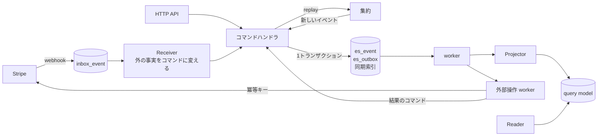

# Event Sourcing + CQRS 移行ロードマップ

## 目的

- 今の決済の「外から届いたイベントを残して同期で投影する」形を、**集約・コマンド・イベントを持つ汎用の Event Sourcing + CQRS** に移す
- 決済に限らず、今後のドメイン（Store・Product・注文・クリエイターへの支払い）でも同じ基盤を使えるようにする
- 自サービスの操作（申し込み・解約・送金）も事実として残し、外部 API の二重実行を防げるようにする
- イベントの保存形式を版で管理し、何年たっても過去のイベントを読めるようにする

## 進め方の原則

- **基盤（型・テーブル・検査）を先に入れ、集約は1つずつ移す**。移している間も、今の決済は動かし続ける
- 各 PR は **独立してマージ可能** な単位に切る。旧テーブルの削除は、読み手を全部移した後にまとめて行う
- 業務判断と状態遷移は純粋な関数にする。時刻・採番・外部 API の応答は呼び出し側が渡し、保存・配信・外部操作も呼び出し側が担う
- BE は Result 型の規約（[backend.md](backend.md)）に従う
- mypy・ruff・pytest を pass させる。集約ごとに `apply`・`replay`・競合のテストを必ず書く

---

## 現状と目標

| 観点 | 現状（2026-11-04） | 目標 |
|---|---|---|
| 正本 | `PaymentEvent`（Stripe の webhook） | `es_event`（集約ごとの履歴）。webhook は受信記録（Inbox）として別に残す |
| イベントの出どころ | 外から届いた事実だけ | 集約がコマンドを判断して生む。外の事実もコマンドとして集約に受理させる |
| 状態 | 投影したテーブル（`Subscription` など）が現在の状態 | 集約の状態は履歴から `replay` で復元する。テーブルは読み取り用の query model |
| 順序と競合 | `occurred_at` と `last_event_at` の比較（秒単位で同時刻があり得る） | 集約内の連番 `seq` と、`(aggregate_type, aggregate_id, seq)` の一意制約 |
| 冪等性 | `(provider, event_id)` の一意制約 | Inbox の一意制約、要求イベントの EventId を外部 API の冪等キーにする、事実索引の一意制約 |
| 投影 | webhook のトランザクションの中で同期に投影 | Outbox → worker → Projector で非同期に投影。進捗 `last_applied_seq` を投影と一緒に保存する |
| 自サービスの操作 | checkout・解約は Stripe を直接呼ぶだけ | 「要求」と「結果」を別のイベントにする |
| 保存形式の変更 | 版なし | `<Aggregate>.<Event>.V<n>` と保存スキーマの検査 |
| 作り直し | 投影を全部消して1トランザクションで流し直す | Projector ごとに世代を分けて再投影する |
| 配信 | `WebhookOutbox`（送信はスタブ） | `es_outbox` と worker。失敗したものは退避して、コマンドで再投入する |

---

## 全体設計の最終形（参考）



### テーブル

| テーブル | 役割 | 主な制約 |
|---|---|---|
| `es_event` | 集約ごとのイベント履歴（追記のみ） | `(aggregate_type, aggregate_id, seq)` 一意 |
| `es_outbox` | 確定したイベントの配信記録 | `(aggregate_type, aggregate_id, seq)` 一意。配信後に消す |
| `es_snapshot` | 集約の状態のキャッシュ | 主キー `(aggregate_type, aggregate_id)`。`codec_version` が違えば使わない |
| `es_projection_progress` | Projector ごとの進捗 | 主キー `(projector, generation, aggregate_type, aggregate_id)` |
| `es_dead_letter` | 再試行を使い切った配信 | 再投入コマンドで戻す |
| `inbox_event` | 外部（Stripe など）から届いたイベント | `(provider, event_id)` 一意。今の `PaymentEvent` を引き継ぐ |
| `es_<集約>_lookup` | 同期検索索引（宛先の解決用） | 集約と同じトランザクションで更新する |
| `es_<集約>_<事実>_index` | 事実索引（一意性・過去の事実への参照） | 追記のみ。一意性の軸に制約を付ける |

### コードの置き場

| 置き場 | 内容 |
|---|---|
| `api/db/models/es.py` | 上の `es_*` テーブル |
| `api/src/domain/interface/es/` | 基盤の型（`EventEnvelope`）と `EventStoreInterface`（ほかのドメインの Interface と同じ置き場） |
| `api/src/domain/aggregate/<集約>/` | 集約ごとの状態（判別共用体）・イベント・コマンド・`apply`・`replay`。I/O を持たない |
| `api/src/domain/entity/es/` | `EventStoreRepository`（Django ORM の実装）。イベントの種類の名前 ↔ dataclass の対応を受け取り、`_convert.py` で保存形式と変換する |
| `api/src/usecase/command/handler.py` | 共通のコマンドハンドラ `handle_command`（取得 → 判断 → 保存 → 競合なら取り直す） |
| `api/src/usecase/command/<集約>.py` | 集約ごとのコマンド |
| `api/utils/functions/es.py` | `new_event_id`（集約・`seq` から決まる UUID v5） |
| `api/src/usecase/receiver/` | Receiver（外の事実やほかの集約のイベントを受けてコマンドを打つ） |
| `api/src/usecase/projector/` | Projector と専用の Writer |
| `api/src/usecase/query/` | query usecase と専用の Reader |
| `api/db/management/commands/` | worker（`run_outbox_dispatcher`・`run_projectors`・`run_external_operations`）と、再投入・再投影のコマンド |

### 基盤の型（イメージ）

```python
@dataclass(frozen=True, slots=True)
class EventEnvelope[E]:
    event_id: UUID            # uuid5(NAMESPACE, f"{aggregate_type}:{aggregate_id}:{seq}")
    aggregate_type: str
    aggregate_id: str
    seq: int                  # 集約内で 1 から連続する
    event_type: str           # "Subscription.Activated.V1"
    occurred_at: datetime
    event: E

class EventStoreInterface(ABC):
    @abstractmethod
    def load(self, aggregate_type: str, aggregate_id: str, after_seq: int) -> Result[list[EventEnvelope[Any]], FatalError]: ...

    @abstractmethod
    def append(self, events: list[EventEnvelope[Any]]) -> Result[None, ConflictError | FatalError]: ...
```

```python
# 集約の状態は判別共用体。apply は次の seq と受理できる種類を確かめて次の状態を返す
type SubscriptionState = SubscriptionPending | SubscriptionActive | SubscriptionPastDue | SubscriptionCanceled

def apply(state: SubscriptionState | None, envelope: EventEnvelope[SubscriptionEvent]) -> Result[SubscriptionState, HistoryCorruptedError]: ...
def replay(base: SubscriptionState | None, envelopes: list[EventEnvelope[SubscriptionEvent]]) -> Result[SubscriptionState, HistoryCorruptedError]: ...
```

---

## 決めること（着手前）

| # | 決めること | 候補・推奨 |
|---|---|---|
| D1 | 競合を表すエラー型 | → 決定：`ConflictError`（再試行できる）を共通のエラー型に足す。HTTP は今の規約に合わせて 400 |
| D2 | 履歴の破損を表すエラー型 | → 決定：`HistoryCorruptedError`（再試行できない）を足し、`FatalError` と分けてログ・通知する |
| D3 | 集約 ID の採番 | → 決定：ULID を既定にする（今の他ドメインと揃える）。自然キーから決めるのは、失効して作り直しても同じ履歴が続くときだけ |
| D4 | worker の動かし方 | → 決定：まずは DB を定期的に読む worker（docker-compose に `myus_worker` を足す）。件数が増えたら Redis Streams か SQS を検討する |
| D5 | 帳簿の集約の単位 | → 決定：決済会社 × 会計年度（`Ledger(provider, fiscal_year)`）。年度で閉じられるので、イベントが際限なく増えない |
| D6 | 既存データの移し方 | → 決定：今の `PaymentEvent` を Inbox として流し直し、集約のイベントを作る（移行用のイベントは作らない）。流し直した結果と今のテーブルを突き合わせる |
| D7 | 決済以外への展開 | → 決定：最初は決済だけにする。メディア・フォローなどの CRUD は ES にしない（後述の「やらないこと」） |

---

## PR 計画

### ✅ Phase 1: ES の基盤

PR #1〜#3 を1つの PR にまとめた。計画から変えたこと：

- 作ったテーブルは `es_event`・`es_outbox` だけ。`es_snapshot`・`es_projection_progress`・`es_dead_letter` は、使う Phase（snapshot は必要になってから、進捗は Phase 6、dead letter は Phase 3）で足す。`SnapshotStoreInterface`・`OutboxInterface` も同じ
- `EventStoreInterface` の `load`・`append` は、ほかの Interface の決まり（`get_ids`・`bulk_get` など）の例外にする。イベントの読み書きはその組み合わせでは書けないため
- `EventEnvelope` は `event_type` を持たない。種類の名前は、`EventStoreRepository` に渡す対応表から dataclass で引く
- `payload` は `PaymentEvent.content` と同じく TextField（pydantic の `TypeAdapter` で JSON にする）
- `ConflictError` の HTTP は、`docs/backend.md` の決まり（200・400・500 だけ）に合わせて 400 にする（D1）
- Repository は injector にまだ登録しない。最初の集約（Phase 4）で、その集約のイベントの対応表と一緒に登録する

#### PR #1: 基盤の型とテーブル

**Goal**: 集約に依存しない基盤を入れる。既存機能は変えない。

**Scope**:
- `api/db/models/es.py`：`EsEvent`・`EsOutbox`・`EsSnapshot`・`EsProjectionProgress`・`EsDeadLetter`（payload は MySQL の JSON 型）
- `api/src/domain/es/`：`EventEnvelope`・`EventId` の派生関数・`EventStoreInterface`・`SnapshotStoreInterface`・`OutboxInterface`
- `api/utils/common/result/errors.py`：`ConflictError`・`HistoryCorruptedError`（D1・D2）
- `docs/backend.md`：エラー型の表に2つを足す

**Acceptance**:
- migration が通る
- mypy・ruff・pytest が pass する

#### PR #2: イベントストアの実装

**Goal**: 追記と読み込みを動かす。

**Scope**:
- `api/src/domain/entity/es/event_store.py`：`append` はイベントと outbox の行を1トランザクションで書く。一意制約の違反（Django の `IntegrityError`）は `ConflictError` に変える
- `load` は `after_seq` より後を `seq` 順に返す。`seq` が飛んでいたら `HistoryCorruptedError` を返す
- `api/src/domain/entity/es/codec.py`：`event_type` ↔ dataclass の登録表。登録のない種類は読み込みを失敗させる
- `injectors/` への登録

**Acceptance**:
- 同じ集約・同じ `seq` に2回追記すると、2回目が `ConflictError` になるテスト
- イベントと outbox の片方だけが残らないテスト（途中で失敗させてロールバックを確かめる）

#### PR #3: コマンドハンドラの共通部品

**Goal**: 「取得 → 判断 → 保存 → 競合なら取り直す」を共通にする。

**Scope**:
- `api/src/usecase/command/_handler.py`：集約を `replay` で取得し、コマンドの関数に渡し、返ったイベントを保存する。`ConflictError` のときは決めた回数まで取り直す
- 拒否・no-op のときはイベントを保存しない
- snapshot があればそこから続きを `replay` する（`codec_version` が違えば使わない）

**Acceptance**:
- テスト用の小さな集約（カウンタなど）で、並行して保存したときに片方が取り直して正しい結果になる

### ✅ Phase 2: 保存契約の検査

#### PR #4: イベントの保存スキーマを固定して検査する

今の `PaymentEvent` の `content` に先に入れ、Phase 4 で集約のイベントも載せた（`api/tests/payment_event_schema/`・`api/tests/es_event_schema/`・`export_event_schema`・`test_event_schema.py`）。

**Goal**: 実際のイベントを保存し始める前に、壊す変更を CI で止められるようにする。

**Scope**:
- codec に登録した全イベントの JSON スキーマを `api/tests/es_schema/*.json` に出すコマンド
- pytest で「今の定義」と「保存済みのスキーマ」を比べる。項目の削除・型の変更・必須化は失敗にし、新しい版の追加か、欠けてもよい項目の追加だけを許す
- 比べる元のファイルを作り直すだけで検査が通る形にしない（過去の版のファイルは消さない）
- `docs/backend.md` に、イベントの命名（`<Aggregate>.<Event>.V<n>`）と変え方の規約を足す

**Acceptance**:
- わざと項目を消すと CI が落ちる

### ✅ Phase 3: 外部イベントの受け口を分ける

PR #5・#6 を1つの PR にまとめた。計画から変えたこと：

- `PaymentEvent` は `inbox_event` に名前を変えず、そのまま Inbox として使う（名前を変えても動きは変わらず、変更が大きいため）。処理の状況（`processed_at`・`attempts`・`last_error`）を足した
- Receiver は分けず、worker（`process_payment_events`）が今の `apply_payment_event` を呼ぶ。Receiver は Phase 4 で集約へのコマンドに変えるときに作る
- 行のロック（`SKIP LOCKED`）は入れず、worker は1つだけ動かす。今の件数では1つで足りる。2つ以上にするときに入れる
- `es_dead_letter` は作らず、失敗の回数が上限（30回）に達したイベントを処理の対象から外して `log.error` を出す。`requeue_payment_events` で回数を 0 に戻す。`es_outbox` の配信を作るときに、そちらの扱いを決める
- `WebhookOutbox`・`dispatch_webhook_outbox` は消した（送信先が無いスタブだったため）。`es_outbox` の配信は Phase 6 で作る

#### PR #5: Inbox と Receiver

**Goal**: webhook を「受けて記録するだけ」にし、集約への反映を Receiver に移す準備をする。

**Scope**:
- `PaymentEvent` を `inbox_event` に名前を変える（`provider`・`event_id` の一意制約・`payload`・`content` はそのまま）
- webhook は検証して Inbox に記録したら 200 を返す
- Receiver（`api/src/usecase/receiver/stripe.py`）：Inbox の行を読み、集約へのコマンドに変える。この PR では今の `apply_payment_event` を呼ぶだけにする（動きは変えない）
- Inbox の処理状況（`processed_at`・`attempts`・`last_error`）を持たせ、worker で順に処理する

**Acceptance**:
- 同じ webhook を2回送っても、Receiver の処理は1回だけになる
- webhook の応答が投影の処理を待たない

#### PR #6: worker を動かす

**Goal**: 非同期の処理を動かす土台を作る。

**Scope**:
- `api/db/management/commands/run_worker.py`：Inbox・outbox を定期的に読み、行をロックして（`SELECT ... FOR UPDATE SKIP LOCKED`）処理する
- docker-compose に `myus_worker` を足す（D4）
- 再試行の上限を超えたら `es_dead_letter` へ移し、`log.error` を出す
- `requeue_dead_letters` コマンド
- `WebhookOutbox` と `dispatch_webhook_outbox` を消す（`es_outbox` に置き換える）

**Acceptance**:
- worker を2つ動かしても、同じ行を二重に処理しない
- わざと失敗させた行が dead letter に移り、再投入で処理される

### 🔶 Phase 4: 最初の集約（Subscription）

#### ✅ PR #7: Subscription 集約

計画から変えたこと：

- 置き場は `api/src/domain/aggregate/subscription/`（`data.py`：状態・イベント・種類の名前の対応表 `SUBSCRIPTION_EVENT_CLASSES`、`aggregate.py`：`accept_provider_state`・`apply_subscription`・`replay_subscription`）
- 状態は `IncompleteSubscription`・`ActiveSubscription`・`PastDueSubscription`・`EndedSubscription`（解約・失効。`status` で分ける）。どれも今の内容（`SubscriptionDetail`）・`seq`・最後に受理した事実の日時を持つ
- イベントは決済会社の事実を受理するものだけにした：`Opened`・`Activated`・`Renewed`（期間の更新）・`PlanChanged`・`PaymentPastDue`・`CancellationScheduled`（期間の終わりでの解約の予約）・`Ended`。`Requested`・`CancellationRequested` とコマンドの `request`・`request_cancellation` は、自サービスの操作を扱う Phase 5 で足す
- 順番は、日時の比較を集約の中で行う（決済会社の状態は行ったり来たりするため、状態の比較だけでは古い事実を見分けられない）。ただし同じ日時の事実は受理し、終わった（`EndedSubscription`）後と、始まった後の `Incomplete` は受理しない。これで、同じ秒に届いた「有効」と「解約」は、届く順に関係なく解約になる
- 集約のイベントも Phase 2 のスキーマの検査に載せた

**Goal**: サブスクリプションを集約にする（I/O なしの部分だけ）。

**Scope**:
- `api/src/domain/aggregate/subscription/`
  - 状態：`SubscriptionPending`・`SubscriptionActive`・`SubscriptionPastDue`・`SubscriptionCanceled`
  - イベント：`Subscription.Requested.V1`・`Subscription.Activated.V1`・`Subscription.PlanChanged.V1`・`Subscription.PaymentPastDue.V1`・`Subscription.CancellationRequested.V1`・`Subscription.Canceled.V1`
  - コマンド：`request`・`accept_provider_state`（外の事実を受理する）・`request_cancellation`
- `accept_provider_state` は、決済会社の状態と今の状態を比べて、必要なイベントだけを生む。同じ状態なら no-op にする（`occurred_at` の比較をやめる）
- 状態ごとに、受理できるイベントと拒否するイベントを網羅したテスト

**Acceptance**:
- 届く順番を入れ替えても、最終的な状態が同じになるテスト

#### PR #8: Subscription の Repository・同期索引・コマンドハンドラ

**Goal**: Subscription を実際に保存する。

**Scope**:
- `es_subscription_lookup`：`(provider, external_id)`・`(user_id)` から集約 ID を引く。集約と同じトランザクションで更新する
- Finder：`find_by_external_id`・`find_by_user`
- コマンドハンドラ：`api/src/usecase/command/subscription.py`
- Receiver が `customer.subscription.*` を `accept_provider_state` に変えて打つ
- 今の `Subscription` テーブルへの書き込みは、この時点では残す（並行して書く）

**Acceptance**:
- Stripe CLI で webhook を送り、`es_event` と今の `Subscription` の両方が正しく更新される

#### PR #9: 既存データを移して、読み手を切り替える

**Goal**: プランの表示を集約から読むようにする。

**Scope**:
- `migrate_subscriptions_to_es` コマンド：Inbox を古い順に Receiver に流し、集約を作る（D6）
- 流した結果の状態と、今の `Subscription`・`UserPlan` を突き合わせるコマンド。違いがあれば一覧を出す
- マイページ・料金プランの画面は、Repository で集約1件を読んで表示する
- `update_user_plan` を、`Subscription` の Projector にする（ユーザーのプランは query model）

**Acceptance**:
- 突き合わせで違いが0件
- 画面の表示が変わらない

### ⏸ Phase 5: 外部操作を要求と結果に分ける

#### PR #10: Stripe の冪等キー

通信の失敗で送り直すときの冪等キーは、Stripe の SDK が自動で付けている（`max_network_retries=2`、POST に `Idempotency-Key` を自動生成）。そのため単独では入れず、PR #11・#12 で要求の EventId をキーにするときにまとめて行う。

**Goal**: 同じ要求で Stripe を2回呼んでも、効果が1回になるようにする。

**Scope**:
- `PaymentInterface` の書き込み系の操作（checkout の作成・解約）に `idempotency_key` を渡す
- Stripe の実装で `idempotency_key` を付けて呼ぶ

#### PR #11: 解約を要求と結果にする

**Goal**: 解約の二重実行と「結果が分からない」状態を扱えるようにする。

**Scope**:
- `POST /payment/cancel` は `request_cancellation` を打つだけにする（`Subscription.CancellationRequested.V1`）
- 外部操作の worker：未決着の要求を見つけ、その EventId を冪等キーにして Stripe を呼び、結果を `Subscription.CancellationAccepted.V1`・`Subscription.CancellationFailed.V1` として記録する
- 結果が分からないとき（タイムアウトなど）は、同じ冪等キーで再試行する
- 画面に「解約を受け付けました」の状態を出す

**Acceptance**:
- 解約ボタンを連打しても、Stripe の解約は1回だけ
- worker を途中で止めて再開しても、二重に解約しない

#### PR #12: checkout を要求と結果にする

**Goal**: 申し込みも事実として残す。

**Scope**:
- checkout はすぐに URL を返す必要があるので、リクエストの中で「要求を保存 → Stripe を呼ぶ → 結果を保存」を順に行う（要求と結果は別のトランザクション）
- 結果を保存する前に落ちたときは、外部操作の worker が同じ冪等キーで結果を確かめる
- `Subscription.Requested.V1` から、webhook の `Subscription.Activated.V1` までを1つの集約の履歴でたどれるようにする

### ⏸ Phase 6: Projector と query model

#### PR #13: Projector の基盤

**Goal**: 非同期の投影を、重複・順序の入れ替わりに強い形で動かす。

**Scope**:
- `es_outbox` の通知は「どの集約に新しいイベントがあるか」だけに使い、イベントはイベントストアから取り直す（backfill）
- 投影の結果と `last_applied_seq` を同じトランザクションで保存する。保存済みより進んでいないときは保存しない
- Projector ごとに専用の Writer を持たせる

**Acceptance**:
- 同じ通知が2回届いても、通知が抜けても、最終的な query model が同じになるテスト

#### PR #14: 再投影を世代で切り替える

**Goal**: 今の「全部消して流し直す」をやめる。

**Scope**:
- query model と進捗に `generation` を持たせ、新しい世代を並行して作る
- 追いついたら読み取り先を新しい世代に切り替え、古い世代を消す
- `replay_payment_events` を `reproject --projector <name>` に置き換える

**Acceptance**:
- 再投影の間も画面が読める

### ⏸ Phase 7: 取引・入金・帳簿

#### PR #15: PaymentTransaction・PaymentPayout の集約

**Scope**:
- `PaymentTransaction` 集約：`Transaction.Paid.V1`・`Transaction.Failed.V1`・`Transaction.Refunded.V1`
- `PaymentPayout` 集約：`Payout.Paid.V1`
- 支払いのイベントがサブスクリプションより先に届いたときは、Receiver が失敗にして再試行に回す（今と同じ扱い）
- 今のテーブルは query model にする

#### PR #16: Ledger 集約と事実索引

**Goal**: 帳簿を、重複して記帳できない形にする。

**Scope**:
- `Ledger` 集約（D5）：`Ledger.EntryRecorded.V1`・`Ledger.Closed.V1`
- 明細の当時の値（金額・消費税額・種類）はイベントに持たせ、集約の状態には合計など判断に要る値だけを残す
- 事実索引 `es_ledger_entry_index`：`(ledger_id, idempotency_key)` 一意（キーは残高の取引の ID と種類から作る）。`seq`・EventId だけを持ち、値はイベントから引く
- 取引・返金・入金の集約のイベントを受けた Receiver が、Ledger にコマンドを打つ
- 年度を閉じたら新しい記帳を拒否する

**Acceptance**:
- 同じ明細を2回記帳しようとすると、2回目は重複のエラーになる

#### PR #17: 帳簿の query model と CSV

**Scope**:
- 帳簿の明細の query model（今の `PaymentLedgerEntry` と同じ列）を Projector で作る
- `export_ledger` を query model から読む形にする

### ⏸ Phase 8: 旧構成の撤去

#### PR #18: 旧テーブル・旧処理の削除

**Scope**:
- `apply_payment_event`・`last_event_at` の比較・`replay_payment_events` を消す
- query model にしなかった旧テーブル・カラムを消す
- `docs/myus.md` の「決済システム」と `docs/architecture.md` を新しい構成に書き直す

**Acceptance**:
- 決済まわりの usecase が Django ORM・Stripe SDK を直接使っていない
- `es_event` から全 query model を作り直せる

---

## Connect・Store への影響

[roadmap_payment.md](roadmap_payment.md) の PR #7〜#10（クリエイターへの支払い、Store・Product・Price）は、**このロードマップの Phase 7 の後に進める**。

- `PaymentSeller`・`Store`・`Product` は最初から集約として作る
- 送金（`Transfer`・`TransferReversal`）は、Ledger 集約のイベントとして足す
- 販売者の口座の作成のように集約より先に外部で番号が振られるものは、外部で作ってから集約を保存し、失敗したときの後始末を usecase で決める

## やらないこと

- **メディア・コメント・フォロー・通知などの CRUD は ES にしない**。履歴に業務上の意味がなく、普通のテーブルで足りる
- **最初からメッセージ基盤（SQS・Kafka）を入れない**。DB の outbox と worker で始め、件数や遅延が問題になってから替える（基盤の interface を保てば、置き換えても usecase は変わらない）
- **全集約に snapshot を付けない**。イベントが多い集約（Ledger）で、全件の `replay` が遅くなってから付ける

## リスクと対策

| リスク | 対策 |
|---|---|
| 移行中に、旧テーブルと集約の状態が食い違う | Phase 4 は並行して書き、突き合わせのコマンドで違いが0件になってから読み手を切り替える |
| 非同期の投影で、書いた直後に画面へ反映されない | 集約1件の表示は Repository から読む。一覧・集計だけを query model から読む |
| worker が止まって投影や外部操作が進まない | 未処理の件数と最も古い行の時刻をログに出し、閾値を超えたら通知する |
| 1人で進めるには部品が多い | Phase ごとに止めても動く形にしてある。Phase 4 までで、順序の問題（同じ時刻のイベント）は解消できる |
| イベントの形を変えて、過去のイベントが読めなくなる | Phase 2 の検査を、実際のイベントを保存する前に入れる |
