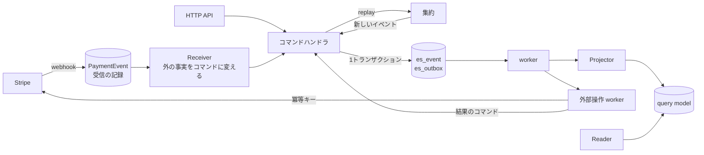

# Event Sourcing + CQRS ロードマップ（残り）

## 目的

- 決済を、集約・コマンド・イベントを持つ Event Sourcing + CQRS に移す
- 自サービスの操作（申し込み・解約・送金）も事実として残し、外部 API の二重実行を防げるようにする
- イベントの保存形式を版で管理し、何年たっても過去のイベントを読めるようにする

## 今の状態

Phase 1〜4 は完了した（ES の基盤・保存形式の検査・webhook の受け口と worker・Subscription 集約）。今の仕組みは [myus.md](myus.md) の「決済システム」、コードの決まりは [backend.md](backend.md) にある。

Phase 5 以降は **保留**（進めるかは未定）。今の規模では、Phase 4 まで（届く順番の問題の解消）で実用上の効果はほぼ出ている。たとえば解約は Stripe の `cancel_at_period_end` を付けるだけで、2回呼んでも二重には解約されない。進めるときは、その時点の規模と問題を見て Phase ごとに決める。

## 進め方の原則

- 集約は1つずつ移す。移している間も、今の決済は動かし続ける
- 各 PR は独立してマージできる単位に切る。旧テーブルの削除は、読み手を全部移した後にまとめて行う
- 業務判断と状態遷移は純粋な関数にする。時刻・採番・外部 API の応答は呼び出し側が渡し、保存・配信・外部操作も呼び出し側が担う
- 集約の ID は、自然に一意に決まるもの（決済会社の ID など）があればそれから作る（例：`stripe:sub_xxx`）。ID を引くためだけの表は作らない
- 集約やイベントストアのテストは、ドメインと実装が固まるまで書かない
- worker は DB を定期的に読む形で始める。件数が増えたら Redis Streams か SQS を検討する

---

## 全体設計の最終形（参考）

| テーブル | 役割 | 状態 |
|---|---|---|
| `es_event` | 集約ごとのイベント履歴（追記のみ）。`(aggregate_type, aggregate_id, seq)` 一意 | あり |
| `es_outbox` | 確定したイベントの配信記録 | あり（配信は Phase 6） |
| `es_projection_progress` | Projector ごとの進捗 | Phase 6 で足す |
| `es_snapshot` | 集約の状態のキャッシュ | イベントが多い集約（Ledger）で `replay` が遅くなってから足す |
| `es_<集約>_<事実>_index` | 事実索引（一意性・過去の事実への参照）。追記のみ | Phase 7（Ledger）で足す |

| 置き場 | 内容 | 状態 |
|---|---|---|
| `api/src/domain/aggregate/<集約>/` | `state.py`・`event.py`・`decide.py`・`apply.py`。I/O を持たない | あり |
| `api/src/usecase/es/_convert.py` | `handle_command`（集約に書き込む共通の手順） | あり |
| `api/src/usecase/<ドメイン>/_convert.py` | 集約ごとのコマンド（`payment` の `save_subscription_event_data` など） | あり |
| `api/src/usecase/receiver/` | Receiver（外の事実やほかの集約のイベントを受けてコマンドを打つ） | Phase 5 以降 |
| `api/src/usecase/projector/`・`query/` | Projector と専用の Writer、query usecase と Reader | Phase 6 |

---

## ⏸ Phase 5: 外部操作を要求と結果に分ける

- **解約：** `POST /payment/cancel` は `Subscription.CancellationRequested.V1` を記録するだけにする。外部操作の worker が、その EventId を冪等キーにして Stripe を呼び、結果を `CancellationAccepted`・`CancellationFailed` として記録する。結果が分からないとき（タイムアウトなど）は、同じキーで再試行する
- **checkout：** すぐに URL を返す必要があるので、リクエストの中で「要求を保存 → Stripe を呼ぶ → 結果を保存」を順に行う。`Subscription.Requested.V1` から webhook の `Activated` までを1つの集約の履歴でたどれるようにする
- **冪等キー：** 通信の失敗で送り直すときのキーは Stripe の SDK が自動で付けている。要求の EventId をキーにするのは、上の2つと一緒に行う

## ⏸ Phase 6: Projector と query model

- `es_outbox` の通知は「どの集約に新しいイベントがあるか」だけに使い、イベントはイベントストアから取り直す
- 投影の結果と `last_applied_seq` を同じトランザクションで保存する。保存済みより進んでいないときは保存しない
- 再投影は query model と進捗に世代（`generation`）を持たせ、新しい世代を並行して作ってから切り替える。`replay_payment_events` を `reproject --projector <name>` に置き換える

## ⏸ Phase 7: 取引・入金・帳簿

- `PaymentTransaction`（`Paid`・`Failed`・`Refunded`）と `PaymentPayout`（`Paid`）を集約にし、今のテーブルは query model にする
- `Ledger` 集約は決済会社 × 会計年度（`Ledger(provider, fiscal_year)`）。年度を閉じたら新しい記帳を拒否する
- 事実索引 `es_ledger_entry_index`：`(ledger_id, idempotency_key)` 一意。同じ明細を2回記帳しようとすると、2回目は重複のエラーになる
- 帳簿の明細の query model を Projector で作り、`export_ledger` をそこから読む
- クリエイターへの支払い（[roadmap_payment.md](roadmap_payment.md)）はこの後に進める。`PaymentSeller`・`Store`・`Product` は最初から集約として作り、送金（`Transfer`・`TransferReversal`）は Ledger 集約のイベントとして足す

## ⏸ Phase 8: 旧構成の撤去

- `apply_payment_event`・`last_event_at` の比較・`replay_payment_events` を消す
- query model にしなかった旧テーブル・カラムを消す
- 終わったら、決済まわりの usecase が Django ORM・Stripe SDK を直接使わず、`es_event` から全 query model を作り直せる

---

## やらないこと

- **メディア・コメント・フォロー・通知などの CRUD は ES にしない**。履歴に業務上の意味がなく、普通のテーブルで足りる
- **最初からメッセージ基盤（SQS・Kafka）を入れない**。DB の outbox と worker で始め、件数や遅延が問題になってから替える
- **全集約に snapshot を付けない**。イベントが多い集約（Ledger）で、全件の `replay` が遅くなってから付ける

## リスクと対策

| リスク | 対策 |
|---|---|
| 非同期の投影で、書いた直後に画面へ反映されない | 集約1件の表示は Repository から読む。一覧・集計だけを query model から読む |
| worker が止まって投影や外部操作が進まない | 未処理の件数と最も古い行の時刻をログに出し、閾値を超えたら通知する |
| 1人で進めるには部品が多い | Phase ごとに止めても動く形にしてある |
| イベントの形を変えて、過去のイベントが読めなくなる | 保存したスキーマとの比較（`test_schema_compatibility.py`）で止める |
